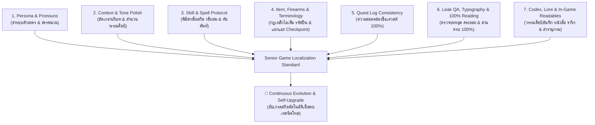
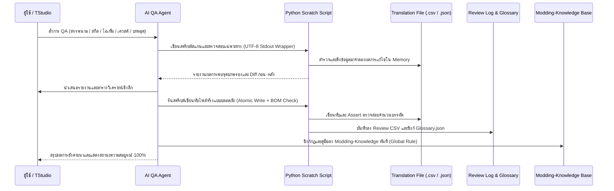

# 🎮 Game Localization QA & Translation Polish Master Protocol (The 7 QA Pillars)

> **Purpose:** กรอบพิธีสารมาตรฐานสากลสำหรับการตรวจแก้ ควบคุมคุณภาพ และขัดเกลาบทแปลเกมภาษาไทยระดับมืออาชีพ (Senior Thai Game Localization Editor & QA Lead) เพื่อยกระดับบทแปลเกมจากการแปลตรงตัวแบบ Machine Translation (MT) ให้เป็นงานวรรณศิลป์เกมระดับ Masterpiece ที่ถูกต้องตาม Lore สละสลวย เข้าปาก ปลอดภัยต่อไฟล์ Mod ของเกม 100% และมีระบบอัปเกรดความรู้และสกิลอย่างต่อเนื่องอัตโนมัติ (Continuous Self-Upgrade Protocol)

---

## 🏛️ สถาปัตยกรรมเสาหลักการตรวจสอบ 7 มิติ (The 7 QA Pillars)



---

### 📌 เสาหลักที่ 1: สารบบตัวละคร สรรพนาม และลำดับชั้นความสัมพันธ์ (Persona & Pronoun Matrix)

1. **ขจัดปัญหากฎทหารเหมารวม (Eradicate the Military Blanket Rule):**
   - ❌ **ข้อห้ามเด็ดขาด:** ห้ามให้ตัวละครหญิง อัศวินหญิง หรือเจ้าหน้าที่หญิงพูดลงท้ายด้วย "ผม/ครับ" หรือใช้สรรพนามชายโดยอ้างว่าเป็นบททหาร
   - ✅ **การปรับใช้:** ให้ตรวจสอบเพศ สถานะทางสังคม และความสัมพันธ์ของตัวละครทุกครั้งก่อนกำหนดสรรพนาม
2. **เมทริกซ์สรรพนามตามบริบทและยุคสมัย (Era & Relationship Matrix):**
   - **แนวแฟนตาซี / ยุคกลาง (High Fantasy / Medieval):**
     - ระหว่างสหาย / นักรบ: `ข้า` - `เจ้า` / `เจ้า` - `ข้า`
     - ต่อผู้มีฐานันดรสูง / กษัตริย์: `ข้าพระพุทธเจ้า` / `ข้า` - `ฝ่าบาท` / `ท่าน` / `ใต้เท้า`
     - ตัวละครหญิงพูดกับคนสนิท: `ฉัน` - `นาย` / `ข้า` - `ท่าน`
     - ผู้รับใช้ / พอว์น ต่อเจ้านาย: `ข้า` / `ข้าพเจ้า` - `นายท่าน` (Master ❌ **ห้ามแปลว่า "อาจารย์"** ในบริบท Pawn/Servant)
   - **แนวไซไฟ / ยุคใหม่ / การทหาร (Modern / Sci-Fi / Military):**
     - เจ้าหน้าที่วิทยุ / AWACS: `ฉัน` / `ทางนี้` - `คุณ` / `ทุกหน่วย`
     - ทหารชาย: `ผม` / `ฉัน` - `ผู้หมวด` / `ผู้กอง` / `ท่าน`
   - **แนวร่วมสมัย / เพื่อนร่วมแก๊ง (Modern Urban / Casual):**
     - เพื่อนสนิท: `ฉัน` - `แก` / `ฉัน` - `นาย` / `กู` - `มึง` (ตามระดับเรตติ้งของเกม)

---

### 📌 เสาหลักที่ 2: ขัดเกลากิริยาบทและบริบท (Context, Mannerisms & Tone Polish)

1. **ขจัดสำนวนแปลตรงตัวแข็งทื่อ (Anti-Literal Translation):**
   - ปรับเปลี่ยนโครงสร้างประโยคแบบภาษาอังกฤษที่ขึ้นต้นด้วยกรรมหรือคำเชื่อมฟุ่มเฟือย ให้เป็นภาษาพูดธรรมชาติที่ "เข้าปากและสละสลวย"
   - ตัวอย่าง:
     - `"It is not impossible that..."` ➔ แปลว่า `"อาจมีหนทางอยู่..."` (❌ ไม่ใช่ `"มันไม่ได้เป็นไปไม่ได้ที่..."`)
     - `"There is no doubt that..."` ➔ แปลว่า `"เห็นได้ชัดว่า..."` / `"แน่นอนว่า..."` (❌ ไม่ใช่ `"ไม่มีข้อสงสัยเลยว่า..."`)
2. **การแปลงสำนวนอุปมาอุปไมย (Idiomatic Transcreation):**
   - ห้ามแปลสำนวนภาษาอังกฤษแบบคำต่อคำ ให้แปลงเป็นสำนวนภาษาไทยที่มีน้ำหนักและความหมายเทียบเท่า:
     - `'Twixt a rock and a hard place` ➔ **"กลืนไม่เข้าคายไม่ออก"** (❌ ไม่ใช่ "ระหว่างหินกับที่แคบ")
     - `No spoils left behind` ➔ **"ไม่ทิ้งของมีค่าไว้เบื้องหลัง"** (❌ ไม่ใช่ "ไม่มีของที่ระลึกถูกทิ้งไว้")
     - `Short-sighted ambition` ➔ **"ความทะเยอทะยานอันมืดบอด"** (❌ ไม่ใช่ "ความทะเยอทะยานสายตาสั้น")
     - `Sculptor's block` ➔ **"ทางตันของประติมากร"** (❌ ไม่ใช่ "กรณีสมองตันของประติมากร")
     - `Bite the bullet` ➔ **"กัดฟันสู้"** / **"ยอมรับชะตากรรม"** (❌ ไม่ใช่ "กัดกระสุน")
     - `Fingers in every pie` ➔ **"แทรกซึมชักใยอยู่เบื้องหลังทุกวงการ"** (❌ ไม่ใช่ "มืออยู่ในทุกพาย")
     - `Earned your rest` ➔ **"เหน็ดเหนื่อยมามากพอแล้ว... จงสู่สุคติเถิด"** (❌ ไม่ใช่ "ได้มาซึ่งการพักผ่อนของเจ้า")
     - `A local miser` (Historical Context) ➔ **"เจ้าชายตกยากในท้องถิ่น"** (❌ ไม่ใช่ "คนขี้เหนียวท้องถิ่น")
     - `Ruined by curiosity` ➔ **"ความใคร่รู้คือหายนะของข้าแท้ๆ"** (❌ ไม่ใช่ "ถูกทำลายด้วยความอยากรู้อยากเห็น")
     - `I do not use that term lightly` ➔ **"ไม่ได้ใช้คำยกย่องนี้พร่ำเพรื่อ"** (❌ ไม่ใช่ "ไม่ได้ใช้คำนั้นอย่างเบาๆ")
     - `Draw fire / Draw their fire` ➔ **"ล่อเป้า"** / **"ดึงความสนใจศัตรู"** (❌ ไม่ใช่ "ยิงไฟ" หรือ "วาดไฟ")
     - `I call shotgun!` (Seating Slang) ➔ **"ฉันขอนั่งเบาะหน้า!"** (❌ ไม่ใช่ "ฉันเรียกปืนลูกซอง!")
     - `Sic Parvis Magna` (Motto) ➔ **"จากจุดเริ่มต้นเล็กๆ สู่ความยิ่งใหญ่ (Sic Parvis Magna)"**

---

### 📌 เสาหลักที่ 3: พิธีสารการแปลสกิลและทักษะต่อสู้ (Skill, Spell & Combat Phrase Protocol)

1. **การค้นคว้าบริบทเชิงลึกก่อนแปล (Mandatory Lore & Animation Research):**
   - AI และผู้แปลต้องตรวจสอบบริบทของเกม คลาสตัวละคร ธาตุที่ใช้ และแอนิเมชันของสกิลก่อนแปลเสมอ ห้ามแปลเดาสุ่ม
2. **การแปลชื่อสกิลแฟนตาซีสั้นๆ เป็นวลีสั้นสละสลวย (Compound Phrasing 2-6 Syllables):**
   - หากเป็นชื่อสกิลสั้น (1-3 คำภาษาอังกฤษ) ให้แปลเป็น **"วลีผสมสั้นๆ 2-6 พยางค์"** ที่ทรงพลัง กระชับ และเห็นภาพการเคลื่อนไหว แทนการแปลยาวทื่อๆ:
     - `Whirlwind Slash` ➔ **"ดาบวายุหมุน"** / **"ฟันรอบทิศ"** (❌ ไม่ใช่ "การฟันลมกรด")
     - `Shield Drum` ➔ **"เคาะโล่ท้าทาย"** (❌ ไม่ใช่ "กลองโล่")
     - `Indomitable Lash` ➔ **"ดาบฟาดไร้พ่าย"** (❌ ไม่ใช่ "แส้ไร้พ่าย")
     - `Heavenly Shot` ➔ **"ศรทิพย์ทะลวงสวรรค์"** (❌ ไม่ใช่ "การยิงจากสวรรค์")
     - `Flame Strike` ➔ **"ดาบเพลิงพิฆาต"** / **"เพลิงจู่โจม"**
     - `Shadow Dance` ➔ **"ระบำเงา"**
     - `Thunder Wrath` ➔ **"อสุนีบาตฟาด"**
     - `Divine Retribution` ➔ **"ทัณฑ์เทวา"**
3. **การทับศัพท์ชื่อเฉพาะและเวทมนตร์ (Proper Nouns & Mythological Spells):**
   - หากเป็นชื่อเฉพาะ เทวตำนาน หรือคำศัพท์เฉพาะที่ไม่มีคำแปลตรงตัว ให้ใช้ **การทับศัพท์ภาษาไทยที่ถูกต้อง** ห้ามแปลแถไปเรื่อยจนความหมายเพี้ยน:
     - `Ragnarok` ➔ **"แร็กนาร็อค"**
     - `Gungnir` ➔ **"กุงเนียร์"**
     - `Megiddo` ➔ **"เมกิดโด"**
     - `Overdrive` ➔ **"โอเวอร์ไดรฟ์"**
     - `Firaga` ➔ **"ฟิเรก้า"**
     - `Wrath of El Dorado` ➔ **"โทสะแห่งเอลโดราโด"**
     - `Spirit of the Djinn` ➔ **"ดวงวิญญาณแห่งญิน"**
     - `Indra's Eternity` ➔ **"วัชระนิรันดร์แห่งพระอินทร์"**
     - `Shield of Asgard` ➔ **"โล่แห่งแอสการ์ด"**
     - `Staff of Ayar Manco` ➔ **"คทาแห่งอายาร์ มันโก"**
     - `Cintamani Stone` ➔ **"ศิลาจินดามณี"**
4. **บัญชีดำคำแปลกลไกสกิลผิดมหันต์ (Gaming Mechanics Anti-MT Blunder Blacklist):**
   - 🛑 `Strike` ➔ ต้องแปลว่า `ฟาดฟัน / จู่โจม / ประหาร` (❌ **ห้ามแปลว่า "นัดหยุดงาน" หรือ "ประท้วงหยุดงาน"**)
   - 🛑 `Cast / Casting` ➔ ต้องแปลว่า `ร่าย / กำลังร่ายเวท` (❌ **ห้ามแปลว่า "หล่อโลหะ" หรือ "คัดเลือกนักแสดง"**)
   - 🛑 `Cooldown` ➔ ต้องแปลว่า `คูลดาวน์ / เวลารอใช้ใหม่` (❌ **ห้ามแปลว่า "เย็นลง" หรือ "การระบายความร้อน"**)
   - 🛑 `Passive Skill` ➔ ต้องแปลว่า `สกิลติดตัว / ทักษะติดตัว` (❌ **ห้ามแปลว่า "ทักษะเฉยชา" หรือ "ไม่กระตือรือร้น"**)
   - 🛑 `Active Skill` ➔ ต้องแปลว่า `สกิลกดใช้ / ทักษะกดใช้` (❌ **ห้ามแปลว่า "ทักษะคล่องแคล่ว" หรือ "กระตือรือร้น"**)
   - 🛑 `Critical Hit` ➔ ต้องแปลว่า `คริติคอล / โจมตีติดคริ` (❌ **ห้ามแปลว่า "การโจมตีวิกฤต" หรือ "วิกฤตการณ์"**)
   - 🛑 `Bleed / Bleeding` ➔ ต้องแปลว่า `ติดเลือดไหล / เลือดออก` (❌ **ห้ามแปลว่า "ตกเลือด" หรือ "เลือดออกทางแผล"**)
   - 🛑 `Stun` ➔ ต้องแปลว่า `สตัน / มึนงง` (❌ **ห้ามแปลว่า "ทำให้ตกตะลึง" หรือ "ทำให้ประหลาดใจ"**)
   - 🛑 `Lifesteal` ➔ ต้องแปลว่า `ดูดเลือด` (❌ **ห้ามแปลว่า "ขโมยชีวิต"**)
   - 🛑 `Respawn` ➔ ต้องแปลว่า `เกิดใหม่ / จุดเกิดใหม่` (❌ **ห้ามแปลว่า "วางไข่" หรือ "การฟักตัว"**)
   - 🛑 `Tank Buster` ➔ ต้องแปลว่า `จอมทลายแทงก์ / มือปราบตัวชน` (❌ **ห้ามแปลว่า "นักทำลายรถถัง"** ในเกมซอมบี้หรือแฟนตาซี)
   - 🛑 `Block Charge` ➔ ต้องแปลว่า `พุ่งชนขณะบล็อก` (❌ **ห้ามแปลกลับด้านกลไกว่า "บล็อกการชาร์จ"**)
   - 🛑 `Bash` ➔ ต้องแปลว่า `พุ่งชนทะลวง` (❌ **ห้ามแปลซ้ำซ้อนกับ Smash ว่า "ทุบ"**)
   - 🛑 `Suicider / Suiciders` ➔ ต้องแปลว่า `ตัวระเบิดพลีชีพ` (❌ **ห้ามแปลว่า "ผู้ฆ่าตัวตาย"**)
    - 🛑 `Eagle Sense` ➔ ต้องแปลว่า `สัมผัสอินทรี (Eagle Sense)` (❌ **ห้ามทับศัพท์ "อีเกิลเซนส์" หรือแปล "in GOLD" เป็น "ในโกลด์"**)
    - 🛑 `Eagle Vision` ➔ ต้องแปลว่า `สายตาอินทรี (Eagle Vision)` (❌ **ห้ามทับศัพท์ "อีเกิลวิชัน" หรือแปล Dismiss เป็น "ไล่ออก"**)
    - 🛑 `Hook and Run / Throw` ➔ ต้องแปลว่า `เกี่ยวตัวข้าม (Hook and Run) / เกี่ยวทุ่ม (Hook and Throw)` (❌ **ห้ามแปลตรงตัว "เกี่ยวและวิ่ง / เกี่ยวและโยน"**)
    - 🛑 `Counter Kill / Combo Kill` ➔ ต้องแปลว่า `สังหารสวนกลับ (Counter Kill) / สังหารต่อเนื่อง (Combo Kill)` (❌ **ห้ามทับศัพท์ "เคาน์เตอร์คิล / คอมโบคิล"**)
    - 🛑 `Leap of Faith` ➔ ต้องแปลว่า `ดิ่งพสุธา (Leap of Faith)` (❌ **ห้ามแปลเวิ่นเว้อ "การก้าวกระโดดแห่งศรัทธา"**)
    - 🛑 `Den Defense / Siege Engine` ➔ ต้องแปลว่า `ศึกป้องกันรังภาคี (Den Defense) / ยุทโธปกรณ์ปิดล้อม` (❌ **ห้ามแปลตรงตัว "ป้องกันรัง / เครื่องยนต์ปิดล้อม"**)

---

### 📌 เสาหลักที่ 4: กฎเหล็กไอเท็ม อาวุธ และคำศัพท์ระบบ (Item, Equipment & Gaming Terminology Protocol)

1. **พิธีสารแยกแยะบริบท Checkpoint 2 กรณี (Dual-Context Checkpoint Protocol):**
   - 🟢 **กรณีที่ 1: กลไกเซฟเกม / จุดเกิดใหม่ / UI ความคืบหน้า (Save Mechanic / Respawn / UI Progress):**
     - สัญญาณ: `reached`, `last`, `previous`, `restart`, `reload`, `save at`, `progress`, `race`, หรือคำว่า `checkpoint` เดี่ยวๆ
     - ✅ **ต้องแปลว่า:** **"เช็คพอยท์"** หรือ **"จุดเช็คพอยท์"**
     - ❌ **ห้ามแปลว่า:** *"จุดตรวจ"* หรือ *"ด่านตรวจ"*
     - ตัวอย่าง: `Checkpoint reached` ➔ `ถึงจุดเช็คพอยท์แล้ว`, `Restart from checkpoint` ➔ `เริ่มใหม่จากจุดเช็คพอยท์`
   - 🔴 **กรณีที่ 2: ด่านตรวจทหาร / ตำรวจ / กองกำลังศัตรู / ชายแดนในเนื้อเรื่อง (Physical In-World Outpost):**
     - สัญญาณ: `military`, `police`, `border`, `enemy`, `soldier`, `guards`, `road`, `highway`, `outpost`, `infiltrate`, `clear`, `attack`, `stationed` (และคำไทย: `ทหาร`, `ตำรวจ`, `ชายแดน`, `ศัตรู`, `ยาม`, `บนถนน`, `บุก`, `กวาดล้าง`)
     - ✅ **ต้องแปลว่า:** **"ด่านตรวจ"** หรือ **"จุดตรวจ"**
     - ❌ **ห้ามแปลหรือแทนที่ด้วย "เช็คพอยท์" เด็ดขาด!** (เช่น `Enemy checkpoint` ➔ `ด่านตรวจของศัตรู` ห้ามแปลเป็น "เช็คพอยท์ของศัตรู", `Guards at the checkpoint` ➔ `ยามที่ด่านตรวจ` ห้ามแปลเป็น "ยามที่เช็คพอยท์")
2. **กฎเหล็กชื่อรุ่นปืน ยุทโธปกรณ์ และขนาดกระสุน (Firearms & Military Calibers):**
   - 🛑 **ข้อห้ามเด็ดขาด:** ห้ามถอดเสียงทับศัพท์ชื่อรุ่นปืนเป็นตัวอักษรไทย (❌ ห้ามแปล: "เอ็ม 60", "เอ็มหกสิบ", "เอเค 47", "กล็อก 19", "อาร์พีจี 7")
   - ✅ **ต้องคงรหัสรุ่นสากลและตัวเลขอารบิกเดิมเสมอ:** `M60`, `M4A1`, `AK-47`, `Glock 19`, `RPG-7`, `Barrett .50 Cal`
   - ✅ **ขนาดกระสุน:** `9mm`, `5.56mm`, `7.62mm`, `.45 ACP`
   - ✅ **คำนำหน้าประเภทภาษาไทย (Thai Classification Prefix):** อนุญาตให้ใส่คำบอกประเภทนำหน้าได้ เช่น `ปืนกล M60`, `ปืนเล็กยาว M4A1`, `ปืนพก Glock 19`, `กระสุน 9mm`
3. **การแปลเครื่องแต่งกายและไอเท็มแฟนตาซี (Fantasy & Medieval Item Traps):**
   - `Breeches` (กางเกงรัดเข่าโบราณ) ➔ **"กางเกง..."** เช่น `Apprentice's Breeches` ➔ **"กางเกงผู้ฝึกเวท"** (❌ ห้ามแปลหลุดออฟฟิศว่า "กางเกงขาสั้นเด็กฝึกงาน")
   - `Hosen` (กางเกงผ้า/สนับขา) ➔ **"กางเกง..."** เช่น `Mercenary Hosen` ➔ **"กางเกงทหารรับจ้าง"** (❌ ห้ามแปลว่า "ถุงน่องทหารรับจ้าง")
   - `Ring of Insomnolence` ➔ **"แหวนต้านนิทรา"** (❌ ไม่ใช่ "แหวนแห่งการนอนไม่หลับ")
   - `Ring of Assurance` ➔ **"แหวนพิทักษ์ชีพ"** (❌ ไม่ใช่ "แหวนประกันชีวิต")
4. **บัญชีดำกับดักแปลไอเท็มและอาวุธปืนผิดมหันต์ (Firearms & Item MT Trap Blacklist):**
   - 🛑 `Burst Fire / Burst Carbine` ➔ ต้องแปลว่า **"ยิงชุด / ปืนคาร์ไบน์ยิงชุด"** (❌ **ห้ามแปลว่า "ยิงระเบิด"**)
   - 🛑 `Boomstick` ➔ ต้องทับศัพท์ว่า **"บูมสติ๊ก"** (❌ **ห้ามแปลตรงตัวว่า "ไม้ตีกอล์ฟ"**)
   - 🛑 `Nailbiter` (Unique Nailgun) ➔ ต้องแปลว่า **"ปืนตะปูเนลไบเตอร์"** (❌ **ห้ามแปลว่า "นักกัดเล็บ / คนกัดเล็บ"**)
   - 🛑 `Numbing Kit` ➔ ต้องแปลว่า **"ชุดยาชา"** (❌ **ห้ามแปลสับสนกับ Tea ว่า "ชุดชา"**)
   - 🛑 `Keycard` ➔ ต้องแปลว่า **"คีย์การ์ด"** (❌ **ห้ามแปลเรียงคำกลับด้านว่า "การ์ดคีย์"**)
   - 🛑 `Muzzle Brake` ➔ ต้องแปลว่า **"ปลอกลดแรงสะท้อนปากกระบอก"** (❌ **ห้ามแปลว่า "เบรกปากกระบอก"**)
   - 🛑 `High-Caliber` ➔ ต้องแปลว่า **"กระสุนขนาดใหญ่พิเศษ"** (❌ **ห้ามแปลว่า "ลำกล้องใหญ่"**)
   - 🛑 `Legal & Municipal Acronyms (L.A.M.C. / C.V.C. / LAPD)` ➔ **ต้องคงตัวย่อภาษาอังกฤษเดิม** (❌ **ห้ามแทนที่ตัวอักษรมั่วเป็น "ล.อ.ม.ซ.", "ค.ว.ซ.", "ส.ต.ล."**)
    - 🛑 `Hidden Blade` ➔ ต้องแปลว่า **"ใบมีดลับ (Hidden Blade)"** (❌ **ห้ามทับศัพท์ดิบว่า "ฮิดเดนเบลด"**)
    - 🛑 `Hidden Gun` ➔ ต้องแปลว่า **"ปืนซ่อนข้อมือ (Hidden Gun)"** (❌ **ห้ามทับศัพท์ว่า "ปืนฮิดเดน"**)
    - 🛑 `War Hammer` ➔ ต้องแปลว่า **"ค้อนสงคราม (War Hammer)"** (❌ **ห้ามแปลกลับคำเป็น "สงครามค้อน"**)
    - 🛑 `Bearded Axe` ➔ ต้องแปลว่า **"ขวานเคราศึกโบราณ (Bearded Axe)"** (❌ **ห้ามแปลตลกเป็น "ขวานมีเครา"**)
    - 🛑 `Riding Spaulders` ➔ ต้องแปลว่า **"สนับไหล่ขี่ม้า (Riding Spaulders)"** (❌ **ห้ามแปลตลกเป็น "ขี่สปอลเดอร์ส"**)
    - 🛑 `Chest Guard` ➔ ต้องแปลว่า **"เกราะอก (Chest Guard)"** (❌ **ห้ามแปลเป็น "เครื่องป้องกันหน้าอก"**)
    - 🛑 `Medicine/Bullet Pouch` ➔ ต้องแปลว่า **"ถุงบรรจุยา / ถุงกระสุน"** (❌ **ห้ามแปลหลุดยุคปัจจุบันเป็น "กระเป๋ายา / กระเป๋ากระสุน"** ในเกมพีเรียดยุคกลาง/เรเนซองส์)
    - 🛑 `Truck (Callsign)` ➔ ต้องแปลว่า **"ทรัค"** (❌ **ห้ามแปลสัญญาณเรียกขานทหารเป็นยานพาหนะ "รถบรรทุก"**)
    - 🛑 `Weapon Model Code (XM25, M4A1, MP5)` ➔ **ต้องคงรหัสรุ่นภาษาอังกฤษเดิม** (❌ **ห้ามทับศัพท์เป็นอักษรไทย "เอ็กซ์เอ็ม 25", "เอ็มสี่"**)
    - 🛑 `Enemy bird` ➔ ต้องแปลว่า **"ฮ. ศัตรู / เฮลิคอปเตอร์ศัตรู"** (❌ **ห้ามแปลสแลงการบินทหารเป็น "นกศัตรู"**)
    - 🛑 `Mother Hen` ➔ ต้องแปลว่า **"มาเธอร์เฮน"** (❌ **ห้ามแปลรหัสวิทยุฐานบัญชาการ/ยานแม่เป็น "แม่ไก่"**)
    - 🛑 `Winch` (Vehicle Recovery Gear) ➔ ต้องแปลว่า **"วินช์ (Winch)"** หรือ **"สลิงดึงรถ"** (❌ **ห้ามแปลสับสนกับ Witch ว่า "แม่มด" เด็ดขาด**)
    - 🛑 `Piton / Climbing Piton` ➔ ต้องแปลว่า **"ลิ่มปีนผา"** (❌ **ห้ามแปลว่า "หมุด" หรือ "ท่อ"**)
    - 🛑 `Lockpick` ➔ ต้องแปลว่า **"ที่สะเดาะกลอน"** (❌ **ห้ามแปลตรงตัวว่า "ตัวเลือกล็อค"**)
    - 🛑 `Shotgun` ➔ ต้องแปลว่า **"ปืนลูกซอง"** (❌ **ห้ามทับศัพท์ว่า "ช็อตกัน"**)
- 🛑 `Sci-Fi Bike (Aratech bike / Speeder bike)` ➔ ต้องแปลว่า **"สปีดเดอร์ไบค์ / สปีดเดอร์ไบค์อาราเทค"** ในเกมไซไฟ/สงครามอวกาศ (❌ **ห้ามแปลตรงตัวว่า "จักรยาน"**)
    - 🛑 `Downed / Downed Operator` ➔ ต้องแปลว่า **"ยิงร่วงหมดสภาพ / ล้มลง"** ในสมรภูมิรบ (❌ **ห้ามแปลว่า "โค่นล้ม"** ซึ่งใช้กับต้นไม้หรือการโค่นล้มอำนาจรัฐบาล)
    - 🛑 `Operator / Operators` ➔ ต้องแปลว่า **"เจ้าหน้าที่ / ทหารประจำหน่วย"** (❌ **ห้ามแปลสับสนเป็น "ปฏิบัติการ"** เช่น `Assign 2 operators` ➔ **"มอบหมายเจ้าหน้าที่ 2 นาย"** ไม่ใช่ส่งไปสองกองร้อย)
    - 🛑 `HMP Droid Gunship / Gunship` ➔ ต้องแปลว่า **"ยานกันชิปดรอยด์ HMP / ยานกันชิป"** (❌ **ห้ามสับสนกับ Artillery Cannon ว่า "ปืนใหญ่"**)
    - 🛑 `PICO electroscope / Electroscope` ➔ ต้องแปลว่า **"กล้องส่องตรวจ PICO / กล้องอิเล็กโทรสโคป"** (❌ **ห้ามแปลตรงตัวว่า "กล้องไฟฟ้า"**)
    - 🛑 `scomp link` ➔ ต้องแปลว่า **"สคอมปลิงก์"** (❌ **ห้ามแปลทื่อเป็น "ลิงก์คอมพิวเตอร์"**)
    - 🛑 `Customization Facility` ➔ ต้องแปลว่า **"ศูนย์ปรับแต่ง"** (❌ **ห้ามแปลแข็งทื่อว่า "สถานที่ปรับแต่ง"**)

---

### 📌 เสาหลักที่ 5: สารบบชื่อเควสและความสอดคล้อง 100% (Quest Log Consistency Protocol)

```
[โครงสร้างไฟล์เควสต์ใน Game Engine (เช่น RE Engine quXXXXXX_log หรือ Anvil DNA Tracker)]
├── Title Row (_log_title / EXACT_TITLE)    ➔ ชื่อที่แสดงในเมนูเควสต์ล็อก / DNA Tracker
├── Completed Row (Completed: <Title>)      ➔ แบนเนอร์แจ้งเตือนตอนจบเควสต์สำเร็จ
├── Failed Row (Failed: <Title>)            ➔ แบนเนอร์แจ้งเตือนตอนจบเควสต์ล้มเหลว
└── Task & Remind Rows (_log_task_...)      ➔ คำอธิบายเป้าหมายและบันทึกเหตุการณ์
```

1. **กฎเหล็กความสอดคล้องระดับอักขระ (Strict Character-for-Character Matching):**
   - ชื่อเควสต์ในเมนู (`_log_title` / DNA Tracker) และชื่อหลังคำว่า `"สำเร็จ: "` / `"ล้มเหลว: "` **ต้องตรงกัน 100% ทุกตัวอักษร**
   - ห้ามมีกรณีชื่อในเมนูเป็นอย่างหนึ่ง แล้วบนหน้าจอแจ้งเตือนขึ้นอีกชื่อหนึ่งเด็ดขาด
2. **การประสานภารกิจแบบหลายตอนต่อเนื่อง (Multi-Part Quest Pair Harmonization):**
   - ภารกิจที่มีหลายตอน (เช่น Part 1 & Part 2, Signs and Symbols I-III) **ต้องใช้วิธีการแปลและระดับภาษาเดียวกัน 100%**:
     - 🛑 **ข้อห้ามเด็ดขาด:** ห้ามให้ตอนที่ 1 ทับศัพท์ แล้วตอนที่ 2 แปลความหมาย (เช่น Part 1 แปลว่า `ดีคอน ตอนที่ 1` แต่ Part 2 ดันแปลว่า `ท่านสังฆานุกร ตอนที่ 2` หรือ Part 1 คือ `เดอะ เซนติเนล ตอนที่ 1` แต่ Part 2 ดันแปลว่า `ผู้พิทักษ์ ตอนที่ 2`)
     - 🛑 **ข้อห้ามเด็ดขาด:** ห้ามปะปนรูปแบบการนับตอน (เช่น ตอนที่ 1 ปะปนกับ ภาคสอง หรือ ภาค 2) ต้องใช้ **`ตอนที่ 1 / ตอนที่ 2 / ตอนที่ 3`** สม่ำเสมอตลอดทั้งเกม
3. **การขจัดหายนะ MT แปล `ESCAPE` เป็นปุ่มคีย์บอร์ด `Esc` (Mission Title ESCAPE Eradication):**
   - 🛑 **ข้อห้ามเด็ดขาด:** ห้ามทึกทักว่าคำว่า `ESCAPE` หรือ `Escape` คือปุ่มคีย์บอร์ด `Esc` ในบริบทที่เป็นชื่อภารกิจหลบหนี, หัวข้อคู่มือการเล่น, หรือแบนเนอร์แจ้งเตือนของเกม ให้แปลว่า **`การหลบหนี`** เสมอ
4. **การประสานชื่อสถานที่ลับ โบราณสถาน และอุโมงค์ส่งน้ำ (Landmarks & Secret Locations):**
   - โบราณสถานขนาดมหึมา (เช่น `Cistern`) ห้ามแปลลดทอนสเกลเป็น *"ถังเก็บน้ำ"* แต่ให้แปลตามสเกลประวัติศาสตร์ว่า **`อุโมงค์ส่งน้ำ / อุโมงค์เก็บน้ำใต้ดิน`**
   - ชื่อลานจัตุรัสและสถานที่ลับ (เช่น `Forum of the Ox`) ต้องรวบรวมการแปลสะเปะสะปะ (*"ลานกระทิง"*, *"ฟอรัมวัว"*, *"ฟอรัมแห่งวัว"*) ให้เป็นหนึ่งเดียวสม่ำเสมอทั้งเกม (เช่น **`จัตุรัสฟอรัมแห่งวัว`**)
5. **การสอดคล้องของแบนเนอร์จบ Sequence (Sequence Completion Banner Alignment):**
   - แบนเนอร์จบ Sequence ทุกตอน ต้องใช้โครงสร้างคำนำหน้าเดียวกันทั้งเกม เช่น `ซิงค์ความทรงจำ: ลำดับที่ %d เสร็จสมบูรณ์` (ห้ามมี Sequence ใด Sequence หนึ่งหลุดขึ้นต้นว่า `ความทรงจำซิงค์แล้ว:...`)
6. **การสืบสานเนื้อเรื่องตัวทดลองทางวิทยาศาสตร์ (Subject 16/17 Lore Consistency):**
   - ในบริบทมนุษย์ทดลองพันธุกรรมของห้องวิจัย (เช่น Abstergo Animus) คำว่า `Subject 16` ต้องแปลว่า **`ตัวทดลองที่ 16 / ร่างทดลองที่ 16`** (❌ ห้ามแปลเป็น "เป้าหมายที่ 16" หรือหลุดความหมายวิกฤตเป็น "หัวข้อสิบหก")
7. **การสอดคล้องของเป้าหมายเควสต์ (Quest Objective Term Alignment):**
   - คำศัพท์ บุคคล และไอเท็มที่ปรากฏในคำอธิบายเป้าหมายเควสต์ ต้องตรงกับชื่อทางการใน Glossary เสมอ (เช่น หากตัวละครคือ *นายกองเสบียง* ห้ามหลุดคำอธิบายเป้าหมายว่า *ส่งจดหมายให้เสบียงกรัง*)
8. **บัญชีดำกับดักการแปลตรงตัวในชื่อและเป้าหมายเควสต์ (Quest Title & Objective MT Trap Blacklist):**
   - 🛑 `Saddle Up for <Location>` ➔ ต้องแปลว่า **"มุ่งหน้าสู่ / เตรียมบุกสู่..."** (❌ **ห้ามแปลตรงตัวว่า "อานม้าสู่..."** ในเกมยุคปัจจุบัน/ที่ไม่มีม้า)
   - 🛑 `Boardwalk / Boardwalking Dead` ➔ ต้องแปลว่า **"ทางเดินเลียบหาด / ซอมบี้เลียบหาด"** (❌ **ห้ามแปลตรงตัวว่า "เดินกระดาน"**)
   - 🛑 `Creature Comforts` ➔ ต้องแปลว่า **"สิ่งอำนวยความสุขสำราญ / ของใช้สำราญใจ"** (❌ **ห้ามแปลผิดร้ายแรงว่า "ความสบายของสัตว์ประหลาด"**)
   - 🛑 `Scooped!` ➔ ต้องแปลว่า **"ชิงข่าวเด็ด!"** ในบริบทนักข่าว/สื่อมวลชน (❌ **ห้ามแปลแบบตักไอศกรีมว่า "ตักมาแล้ว!"**)
   - 🛑 `Blood Drive` ➔ ต้องแปลว่า **"บลัดไดรฟ์ / ปฏิบัติการบลัดไดรฟ์"** ในบริบทอุปกรณ์ตรวจเลือดทางวิทยาศาสตร์ (❌ **ห้ามแปลว่า "เครื่องเจาะเลือด"**)
   - 🛑 `Drunk and Disorderly` ➔ ต้องแปลว่า **"เมาแล้วอาละวาด"** ตามข้อหาคดีอาญา (❌ **ห้ามแปลตรงตัวว่า "เมาแล้วไม่เป็นระเบียบ"**)
   - 🛑 `Rainy Day Stash` ➔ ต้องแปลว่า **"คลังลับยามฉุกเฉิน / เซฟลับยามยาก"** (❌ **ห้ามแปลตรงตัวว่า "ของสะสมวันฝนตก"**)
   - 🛑 `Rage Quit` ➔ ต้องแปลว่า **"หัวร้อนถอนตัว"** (❌ **ห้ามแปลทื่อๆ ว่า "เลิกเล่น"**)
   - 🛑 `The GOAT Pen` ➔ ต้องแปลว่า **"คฤหาสน์โกทเพน"** ในบริบทบ้านรวมคอนเทนต์ครีเอเตอร์/เกมเมอร์ (❌ **ห้ามแปลตรงตัวว่า "คอกแพะ"**)
   - 🛑 `Missing Person Quests` ➔ ต้องใช้คำนำหน้ามาตรฐานเดียวกัน 100% ทั้งโปสเตอร์ กระดานงาน และสมุดเควสต์: **`คนหาย: [ชื่อบุคคล]`** (❌ **ห้ามสับสนปนเปกันระหว่าง "สูญหาย", "หายตัว", "คนหาย"**)
   - 🛑 `DLC Entitlement Prerequisite References` ➔ ข้อความระบุเงื่อนไขปลดล็อกสิทธิ์ DLC หรืออาวุธ (เช่น 'หลังจากทำเควส "..." สำเร็จ') **ต้องตรงกับชื่อเควสต์ที่แปลจริงทุกตัวอักษร 100% ห้ามหลุดชื่อเก่าหรือภาษาอังกฤษค้าง**


---

### 📌 เสาหลักที่ 6: ตรวจจับบทหลุดแปล สระลอย & กฎอ่านครบ 100% (Leak QA, Typography & 100% Line-by-Line)

1. **กฎเหล็กการอ่านครบทุกประโยคแบบ 100% (100% Comprehensive Sentence Reading & Zero Omission):**
   - 🛑 **ระบบและ AI จำเป็นต้องอ่าน ตรวจสอบ และแปล "ทุกประโยค ทุกบรรทัด 100%" ห้ามทำข้ามๆ เด็ดขาด!**
   - ห้ามสรุปย่อ ห้ามสแกนผ่านๆ หรือละไว้ในฐานที่เข้าใจ
   - ตรวจนับ Row Count ก่อนและหลัง เพื่อยืนยันว่าไม่มีแถวใดตกหล่นแม้แต่แถวเดียว
2. **ตรวจจับบทสนทนาหลุดแปล (Dialogue Leak Detection):**
   - **กรณีที่ 1: ช่องคำแปลว่างเปล่า (Empty Target)** เมื่อมีข้อความต้นฉบับ
   - **กรณีที่ 2: บทพูดหลุดภาษาอังกฤษ 100% (Untranslated Speech Leak)** ข้อความภาษาอังกฤษเหมือนต้นฉบับ
   - **กรณีที่ 3: อักษร CJK ตกค้าง** มีตัวอักษรจีน/ญี่ปุ่น/เกาหลีหลงเหลือปนมาในบทแปลภาษาไทย
3. **ระบบตรวจสอบและแก้ไขวรรณยุกต์และสระลอยภาษาไทย (Thai Typography & Tone Mark Quality Engine):**
   - **สระเอซ้อน (เเ):** ตรวจจับ `เ` + `เ` (0E40 + 0E40) และแปลงเป็น `แ` (0E41 - Sara Ae) อัตโนมัติ
   - **วรรณยุกต์สลับที่กับสระบน:** เช่น `่ิ` ➔ แก้เป็น `ิ่ง`
   - **วรรณยุกต์สลับที่กับสระล่าง:** เช่น `ุ่` ➔ แก้เป็น `ุ่ง`
   - **วรรณยุกต์อยู่หลังสระอำ:** เช่น `ทำ่` ➔ แก้เป็น `ท่ำ`
   - **วรรณยุกต์หรือสระซ้อน:** เช่น `ิิ`, `ุุ`, `้้`
   - **สระลอย / วรรณยุกต์ไม่มีพยัญชนะนำ:** ตรวจจับวรรณยุกต์โดดเดี่ยวที่ขึ้นต้นคำหรืออยู่หลังเว้นวรรค
4. **รักษาความปลอดภัยโครงสร้างไฟล์และแท็กเกม (File Structure & Tag Safety):**
   - ห้ามลบ ห้ามแก้ หรือห้ามแปลโค้ดแท็กของเอนจิ้นเกม เช่น `<COLOR FF0000>...</COLOR>`, `<アイコンタグ>`, `<REF...>`, `{0}`, `%s`, `
`
   - รักษารูปแบบการเข้ารหัสไฟล์ (Encoding) เดิมอย่างเคร่งครัด (เช่น `utf-8-sig` มี BOM หรือ `utf-8` แบบไม่มี BOM)
   - ตรวจสอบจำนวนบรรทัดของไฟล์ (Exact Line Count Match) ก่อนและหลังแก้ไข ต้องเท่าเดิมเป๊ะ 100%
5. **การผสานคำศัพท์ภาษาไทยที่ถูกวรรคคั่นกลางคำ (Thai Word Syllable Rejoining):**
   - ในการตัดบรรทัดหรือจัดข้อความซับไตเติลเดิม มักพบการเคาะวรรคกลางคำศัพท์ภาษาไทย เช่น `ลอบสัง หาร` ➔ ต้องผสานเป็น **`ลอบสังหาร`**, `สิ่งประ ดิษฐ์` ➔ **`สิ่งประดิษฐ์`**, `ความห มาย` ➔ **`ความหมาย`**, `ศูนย์ก ลาง` ➔ **`ศูนย์กลาง`**, `เจ็บปว ดรวดร้าว` ➔ **`เจ็บปวดรวดร้าว`**
6. **การแปลเสียงประกอบและท่าทางกำกับในซับไตเติล (Subtitle Sound & Stage Cues Localization):**
   - แท็กบอกเสียงประกอบและกิริยาท่าทางในซับไตเติลที่ไม่ใช่โค้ดเอนจิ้น (เช่น ไม่ใช่ `[IT]`, `[TU]`, `[GR]`, `[beat]`) ต้องได้รับการแปลเป็นภาษาไทยอย่างสละสลวย เช่น:
     - `[Screams]` ➔ **`[เสียงกรีดร้อง]`**
     - `[Crying]` ➔ **`[เสียงร้องไห้]`**
     - `[Laughter]` / `[laugh]` / `[Laughs]` ➔ **`[เสียงหัวเราะ]` / `[หัวเราะ]`**
     - `[Gasp]` ➔ **`[อ้าปากค้าง]`**
     - `[sigh]` / `[Sighs]` ➔ **`[ถอนหายใจ]`**
     - `[Yawning]` ➔ **`[หาว]`**
     - `[small breath]` ➔ **`[สูดหายใจเบาๆ]`**
     - `[sarcastically]` ➔ **`[ประชด]`**
     - `[Spits]` ➔ **`[ถ่มน้ำลาย]`**
     - `[coughing]` ➔ **`[ไอ]`**
     - `[louder]` ➔ **`[เสียงดังขึ้น]`**
7. **การตรวจสอบการเลื่อนแถวของบทเรียน (Tutorial Instruction Misalignment Audit):**
   - ในไฟล์เมนู/บทเรียนการเล่นคู่ (Description + Title) ต้องตรวจสอบเสมอว่าคำอธิบายตรงกับหัวข้อหรือไม่ ป้องกันกรณี MT หรือการคัดลอกเลื่อนแถว เช่น เอาคำสั่ง Counter Kill ไปใส่ในหัวข้อ `PARACHUTE` (ร่มชูชีพ) หรือเอาคำอธิบาย Combo Kill ไปใส่ในคำสั่งกดดู `OBJECTIVES` (วัตถุประสงค์)
8. **การป้องกันสระลอยในข้อความป้ายแนวตั้ง (Vertical Signs with `<br>`):**
   - ป้าย 3D โมเดลแนวตั้งที่คั่นแต่ละบรรทัดด้วย `<br>`: สระบน, สระล่าง และวรรณยุกต์ **ต้องไม่ถูกตัดแบ่งให้ขึ้นบรรทัดใหม่ตามลำพัง** (เช่น `ส<br>น<br>ุก` ➔ ต้องจัดเป็น `ส<br>นุ<br>ก`, `เ<br>ล<br>่<br>น` ➔ ต้องเป็น `ม<br>า<br>เ<br>ล่น`) เพื่อป้องกันสระลอยและข้อผิดพลาดในการตัดคำของเอนจิ้นเกม
   - กฎการประสานแท็ก (Tag Matching Integrity): ต้องคงจำนวนแท็ก `<br>` ให้เท่ากับต้นฉบับเป๊ะตามที่เอนจิ้นเกมบังคับ (Exact Tag Counter Match)
9. **การป้องกันแท็ก HTML ตัดแยกพยัญชนะกับสระ (HTML Tag Separation Glitch):**
   - ห้ามตัดแท็กแบ่งพยัญชนะกับสระบนออกจากกัน เช่น `<b>ม</b>ึง` ➔ เอนจิ้นเกมจะมองว่า `>` อยู่หน้าสระอึ กลายเป็นสระลอย ต้องครอบทั้งพยางค์เป็น `<b>มึง</b>` หรือ `<b>เผื่อ</b>`
10. **การแทนที่เสียงลากยาวโดยไม่ซ้อนสระ (No Vowel Stacking for Dragged Sounds):**
    - ห้ามซ้อนสระบน/ล่างเพื่อลากเสียง เช่น `zoooom!` ➔ ห้ามแปล `ซูููม!`, `Steeeeve?` ➔ ห้ามแปล `สตีีีีฟ?` เพราะฟอนต์เกมจะเรนเดอร์ Glyph ทับซ้อนจนอ่านไม่ออก ให้ลากเสียงพยัญชนะสะกดหรือใส่ไม้ตรีแทน เช่น **`ซู้วววม!`**, **`สตี๊ฟฟฟ?`**
11. **บัญชีดำอักษร CJK และคำศัพท์ตกค้างจาก MT (CJK & Translation Cache Residue Blacklist):**
   - 🛑 `变成` ➔ ต้องแปลว่า `กลายเป็น` (❌ ห้ามหลุดอักษรจีน)
   - 🛑 `那儿 / 那边` ➔ ต้องแปลว่า `ที่นั่น / ตรงนั้น / ฝั่งนั้น`
   - 🛑 `五星` ➔ ต้องแปลว่า `ห้าดาว`
   - 🛑 `交出` ➔ ต้องแปลว่า `ส่งมอบ / ส่ง...มา`
   - 🛑 `不敢相信` ➔ ต้องแปลว่า `ไม่อยากจะเชื่อ`
   - 🛑 `与技术` ➔ ต้องแปลว่า `และเทคโนโลยี`
   - 🛑 `太重` ➔ ต้องแปลว่า `หนักเกินไป / รุนแรงเกินไป`
   - 🛑 `这把` ➔ ต้องแปลว่า `อันนี้ / กระบอกนี้ / ด้ามนี้`
   - 🛑 `那群` ➔ ต้องแปลว่า `กลุ่มนั้น / พวกนั้น`
   - 🛑 `是她` ➔ ต้องแปลว่า `ใช่เธอ / คือเธอ`
   - 🛑 `装备` ➔ ต้องแปลว่า `ช่องใส่อาวุธ / คลังอุปกรณ์`
   - 🛑 `致命` ➔ ต้องแปลว่า `นัดสังหาร / ถึงแก่ชีวิต`
   - 🛑 `只是因为` ➔ ต้องแปลว่า `เพียงเพราะว่า`
   - 🛑 `木板` ➔ ต้องแปลว่า `ไม้กระดาน / แผ่นไม้`
   - 🛑 `确保` ➔ ต้องแปลว่า `คอยดูให้แน่ใจ / ตรวจสอบให้แน่ใจ`
   - 🛑 `消耗品` ➔ ต้องแปลว่า `ไอเท็มใช้งาน / ของใช้สิ้นเปลือง`
   - 🛑 `击中` ➔ ต้องแปลว่า `โดนเข้า / ถูกโจมตี`
   - 🛑 `你有` ➔ ต้องแปลว่า `คุณมี`
12. **การขจัดกับดักขยายศัพท์ย่อยลงวงเล็บแบบตาบอด (Blind Compound Glossary Injection Eradication):**
   - เมื่อระบบ MT พบคำประสมที่เป็นชื่อเฉพาะ (เช่น `Grand Palace`, `Dunwall Tower`, `Grand Guard`) ระบบจะค้นหาความหมายของคำเดี่ยวใน Glossary และฉีดคำแปลย่อยใส่ในวงเล็บท้ายคำ (เช่น `แกรนด์ พาเลซ (ใหญ่ พาเลซ)`, `หอคอยดันวอลล์ (ดันวอลล์ หอคอย)`)
   - 🛑 **ข้อห้ามเด็ดขาด:** ต้องกำจัดวงเล็บขยะเหล่านี้ทิ้ง 100% และคงชื่อเฉพาะทางการที่สละสลวย: **`พระราชวังแกรนด์พาเลซ`**, **`หอคอยดันวอลล์`**, **`แกรนด์ การ์ด`**
13. **พิธีสารแปลหัวข้อบทคัดย่อหนังสือและบันทึก (Book Excerpt Header Protocol):**
   - ในหนังสือ Lore มักขึ้นต้นด้วย `<title>[Excerpt from...]</title>` ซึ่งเครื่องมือแปลมักแปลไม่ครบหรือค้างภาษาอังกฤษ
   - ✅ **ต้องแปลเป็นภาษาไทยสละสลวย 100%:** เช่น `[Excerpt from a book on the late Empress]` ➔ **`[ข้อความคัดตอนจากหนังสือว่าด้วยอดีตจักรพรรดินีผู้ล่วงลับ]`**, `[Excerpt from a longer work of fiction]` ➔ **`[ข้อความคัดตอนจากนวนิยายขนาดยาว]`**
14. **การตรวจจับสิ่งปนเปื้อนข้ามภาษา (Cross-Language MT Bleed Detection):**
   - โมเดล Multilingual MT มักมี Token Hallucination นำเอาคำศัพท์จากภาษาที่ 3 (เช่น ภาษาอาหรับ `نسبี`, ภาษารัสเซีย `доктор`) ปนเข้ามาในประโยคภาษาไทย ต้องใช้ Regex ตรวจสอบ Unicode นอกเหนือจาก Latin, Thai และสัญลักษณ์สากล เพื่อขจัดทิ้งทั้งหมด
15. **การขัดเกลาบทสนทนาพูดในซับไตเติล (Spoken Subtitle Naturalization):**
   - ในบทสนทนาพูด คัตซีน วิทยุสนามรบ หรือเสียงกระซิบของตัวละคร **ห้ามมีคำศัพท์ภาษาอังกฤษในวงเล็บเด็ดขาด** (เช่น `(Barrister)`, `(Gallery)`, `(Durante)`) ให้แปลเป็นภาษาพูดธรรมชาติที่เข้าปาก ไม่สะดุดหู
16. **การกู้คืนแท็กผู้พูดแถวแรกในไฟล์เสียงหลายตัวละคร (Audiograph Opening Speaker Header Recovery):**
   - ในออดิโอกราฟที่ตัวละครหลายคนพูดสลับกัน Void Engine มักวางชื่อตัวละครเปิดไฟล์ไว้หน้า `<br><p>` ตัวแรก เครื่องมือแปลมักทำตกหล่น ต้องตรวจสอบและกู้คืนชื่อผู้พูดเปิดบทสนทนาให้ตรงตามต้นฉบับเสมอ
17. **พิธีสารห้ามตัดทอนคู่มือและทักษะเกมเด็ดขาด (Zero Tutorial & Mechanics Omission Protocol):**
   - ในไฟล์คู่มือ (`TUTORIAL_..._body`) ระบบ MT มักสรุปย่อหรือตัดทอนเนื้อหาคำอธิบายการควบคุม คีย์ลัด (`<GBA_POWER_WEAPON>`), การประสานพลัง (Synergy), และการอัปเกรดทักษะในบล็อกแท็ก `<section>` (`<color>Link Three</color>`, `<color>Link Four</color>`)
   - 🛑 **ข้อห้ามเด็ดขาด:** ห้ามสรุปย่อเนื้อหาคู่มือ ต้องตรวจสอบอัตราส่วนความยาวและแท็กเปิด-ปิด `<section>` เพื่อแปลกู้คืนเนื้อหาคู่มือครบถ้วน 100% พร้อมคงแท็กควบคุมระบบของเกมไว้อย่างสมบูรณ์
18. **การตรวจจับและแก้ไขการแปลกลับทิศทางของประวัติศาสตร์และ Lore (Historical & Narrative Lore Inversion Detection):**
   - เมื่อตัวละครพูดถึงการอพยพหลบหนีภัยสงครามหรือสถานการณ์ภูมิศาสตร์ (เช่น "กำลังย้ายไปมอร์ลีย์ เพราะกริสตอลเกิดศึกและทีเวียหนาวเกินไป") ระบบ MT มักสับสนโครงสร้างประโยคปฏิเสธ/เงื่อนไข แล้วแปลกลับด้านเป็น "จะย้ายไปกริสตอลหรือทีเวีย"
   - 🛑 **ข้อห้ามเด็ดขาด:** ต้องอ่านบริบทความเชื่อมโยงของโลกในเกมให้ครบถ้วน ห้ามให้ความหมายตรงข้ามกับ Lore ทางประวัติศาสตร์ของเกมเด็ดขาด
19. **การตรวจสอบความสมดุลของแท็กเปิด-ปิด 100% (Absolute Tag Balance & Invariance Audit):**
   - เอนจิ้นเกม (เช่น Void Engine, RE Engine, Unreal Engine) ไวต่อแท็กเปิด-ปิด (`<p>...</p>`, `<title>...</title>`, `<color>...</color>`, `<section>...</section>`) อย่างยิ่ง หากแท็กไม่ครบคู่หรือมีแท็กกำพร้า (`<br><p>` โดยไม่มี `</p>`, หรือปิด `</p>` เกินมา) จะส่งผลให้เกม Crash หรือ UI ในเกมพังทลาย
   - 🛑 **ข้อกำหนดบังคับ:** ต้องรันสคริปต์ตรวจสอบจำนวนแท็กเปิดและปิดเทียบกับภาษาอังกฤษทุกแถวให้เท่ากัน 100% (Zero Tag Mismatch Guarantee)
20. **พิธีสารการแปลภาษาหนังสือพิมพ์และพาดหัวข่าวในเกม (In-World Journalism & Newspaper Headline Protocol):**
   - พาดหัวข่าวหนังสือพิมพ์ (Headlines เช่น The Dunwall Courier, The Silver Spike) ต้องกระชับ ทรงพลัง ชวนติดตาม และมีลีลาพาดหัวข่าวหน้าหนึ่งระดับมืออาชีพ
   - 🛑 **ข้อห้ามเด็ดขาด:** ห้ามแปลตรงตัวจนเสียใจความ เช่น `DUKE ABELE INSTRUMENTAL IN COUP` ➔ ❌ ห้ามแปลว่า *"ดยุกอาเบเล่จำเป็นในการรัฐประหาร"* ให้แปลว่า **`ดยุกอาเบเล่ ตัวการสำคัญในการรัฐประหาร!`** หรือ `GRAND INVENTOR FALLS TO CROWN KILLER` ➔ **`ยอดนักประดิษฐ์เอกจบชีวิตลงด้วยน้ำมือคราวน์ คิลเลอร์!`**
   - ต้องแยกแยะระหว่าง **กระบอกเสียงโฆษณาชวนเชื่อของรัฐ (State Propaganda)** ที่สรรเสริญความมั่นคง กับ **สื่อสิ่งพิมพ์ใต้ดินฝ่ายกบฏ (Underground Rebel Press)** ที่กระตุ้นให้ประชาชนลุกฮือ
21. **การรักษาความคงที่ของเทคโนโลยีและวิทยาการยุควิกตอเรียน (Victorian Technology & Artifact Invariance):**
   - เทคโนโลยีโบราณเฉพาะของเกม เช่น การถ่ายภาพด้วยกระจกเคลือบสารเงิน (`Silvergraph`) ในยุคปฏิวัติอุตสาหกรรม/สตีมพังก์
   - 🛑 **ข้อห้ามเด็ดขาด:** ห้ามแปลตรงตัวว่า *"ภาพถ่ายเงิน"* (ซึ่งทำให้ผู้เล่นเข้าใจผิดว่าเป็นภาพวาดสีเงินหรือก้อนเงิน) ต้องแปลทับศัพท์เฉพาะทางว่า **`ภาพถ่ายซิลเวอร์กราฟ`** หรือ **`ซิลเวอร์กราฟ`**
22. **การรักษาความคงที่ของชื่อสปีชีส์และชีววิทยาแฟนตาซี (Fantasy Fauna & Bestiary Invariance):**
   - สัตว์ประหลาดหรือแมลงกินเนื้อที่สร้างรังในศพ เช่น `Bloodfly / Bloodflies` ถือเป็นมอนสเตอร์ประจำแฟรนไชส์
   - 🛑 **ข้อห้ามเด็ดขาด:** ห้ามแปลตรงตัวแบบคำต่อคำว่า *"แมลงวันเลือด / แมลงวันโลหิต"* ให้ทับศัพท์กึ่งแปลเฉพาะทางตามระบบ Lore: **`บลัดฟลาย / ฝูงบลัดฟลาย`** หรือ **`ตัวบลัดฟลาย`** เสมอ เพื่อรักษาความสยดสยองและเอกลักษณ์ของตัวละคร
23. **ความสอดคล้องของระดับภาษาระหว่างนายกับบ่าวในจดหมาย (Master-Servant Register Harmony in Correspondence):**
   - ในจดหมายส่วนตัวหรือบันทึกภายในบ้าน เจ้านายชั้นสูง (เช่น ขุนนาง, นักประดิษฐ์, อารามิส สติลตัน) เขียนถึงคนรับใช้ที่ไว้ใจ (เช่น ไฮเม่) ต้องใช้น้ำเสียงเป็นกันเองแต่คงเกียรติ (`ไฮเม่ผู้ซื่อสัตย์ของข้า`, `สหายเอ๋ย` ไม่ใช่ *"คนดี"*)
   - คนรับใช้เขียนถึงเจ้านายหญิง (เช่น เบรียนนา แอชเวิร์ธ) ต้องใช้สรรพนามและคำลงท้ายที่เคารพนอบน้อม (`นายหญิงเบรียนนา`, `ตามที่ท่านสั่งไว้` ❌ **ห้ามคนรับใช้เรียกเจ้านายหญิงว่า "เจ้า"**)
24. **พิธีสารการกวาดล้างคำศัพท์ทั่วไปออกจากคลังคำศัพท์ (Stop-Word Glossary Sanitization Protocol):**
   - ห้ามบรรจุคำศัพท์ภาษาอังกฤษทั่วไป (เช่น `Grand`, `Palace`, `Guard`, `Light`, `Wall`, `Safe`, `Even`, `Find`, `Good`, `Time`, `Room`, `Letter`) ลงใน Project Glossary เด็ดขาด
   - 🛑 **ข้อห้ามเด็ดขาด:** การใส่คำทั่วไปใน Glossary จะทำให้ระบบ AI หรือ regex auto-matcher แยกส่วนคำประสม (Compound Nouns) จนเกิดคราบแปลวิบัติ เช่น `Grand Palace` ➔ `แกรนด์ พาเลซ (ใหญ่ พาเลซ)`, `Wall of Light` ➔ `กำแพง of แสง`
25. **พิธีสารการสมานฉันท์คำสั่งพรอพพ์และโปรไฟล์ TStudio (TStudio Prompt Directives & Profile Alignment Protocol):**
   - ตรวจสอบคำสั่งระบบ (System Prompt Directives) ใน `.thub/profile/prompts.json` และ `thub_project.json`
   - 🛑 **ข้อห้ามเด็ดขาด:** ห้ามมีคำสั่งบอกให้ AI *"ใส่ภาษาอังกฤษในวงเล็บเสมอ"* ในบทสนทนาพูดหรือซับไตเติล ต้องกำหนดให้ใช้คำแปลทางการตาม Glossary โดยตรงเพื่อขจัดคราบวงเล็บรกสายตา (Clean Subtitle Principle)


---

26. **พิธีสารการจัดการแท็กประเมินผลเงื่อนไขรันไทม์ (Runtime Conditional Localization Tags Protocol) — Marvelous Engine & Game Engines:**
    - เอนจินเกมหลายค่าย (เช่น Marvelous Engine ใน Story of Seasons, Rune Factory หรือเอนจินที่มีระบบแตกแขนงบทพูดตามตัวแปร) ใช้แท็กที่มีตัวเลือกหลายเงื่อนไข เช่น:
      - `<GenderChild:male_choice:female_choice>` (ตัวเลือกตามเพศของลูก)
      - `<GenderSpouse:male_choice:female_choice>` (ตัวเลือกตามเพศของคู่สมรส)
      - `<GenderPlayer:male:female:nonbinary>` (ตัวเลือกตามเพศของตัวเอก 3 เพศ)
    - 🛑 **หลุมพรางคำสั่ง AI (MT Prompt Directive Trap):** หากคำสั่งระบบ (System Directive) สั่งเพียงว่า *"Preserve all tags like <...> exactly as they appear in the source text"* AI จะคัดลอกแท็กภาษาอังกฤษทั้งดุ้น (`<GenderChild:him:her>`, `<GenderChild:son:daughter>`) ส่งผลให้เมื่อเอนจินรันไทม์เลือกเงื่อนไข คำภาษาอังกฤษจะปรากฏแทรกกลางประโยคภาษาไทยทันที (Runtime Leak)
    - 🛑 **กฎเหล็กการแปลแท็กเงื่อนไข (Conditional Tag Translation Rule):**
      - ต้องแยกแยะระหว่าง **แท็กเชิงเทคนิคที่ต้องคงไว้ 100%** (`<button>`, `<clear>`, `<wait:...>`, `<face:...>`, `<se:...>`, `<changefont:...>`, `{LF}`, `{CR}`, `<playername>`, `<childname>`, `<spousename>`, `<item:...>`, `<repnum:...>`, `<repstr:...>`)
      - กับ **แท็กเงื่อนไขที่ต้องแปลตัวเลือกภายในเป็นไทยเสมอ** เช่น:
        - `<GenderChild:him:her>` ➔ **`<GenderChild:เขา:เธอ>`**
        - `<GenderChild:son:daughter>` ➔ **`<GenderChild:ลูกชาย:ลูกสาว>`**
        - `<GenderChild:guy:gal>` ➔ **`<GenderChild:เจ้าหนู:แม่หนู>`**
        - `<GenderSpouse:husband:wife>` ➔ **`<GenderSpouse:สามี:ภรรยา>`**
        - `<GenderPlayer:he:she:they>` ➔ **`<GenderPlayer:เขา:เธอ:คนๆ นี้>`**
      - ต้องรักษาจำนวนโคลอนและโครงสร้างภายนอกของแท็กไว้ให้สมบูรณ์เท่าเดิม เพื่อป้องกันข้อผิดพลาด Structural Token Mismatch

### 📌 เสาหลักที่ 7: พิธีสารการแปลบันทึก ประวัติศาสตร์ และสารานุกรมในเกม (Codex, Lore, Books & In-Game Readables Protocol)

ในวิดีโอเกมระดับ AAA (เช่น The Witcher, Elden Ring, Skyrim, Resident Evil, Dragon Age, Cyberpunk 2077) ตัวละครมักจะต้องเก็บหรือเปิดอ่านเอกสาร หนังสือ บันทึกไดอารี หรือล็อกเทอร์มินัลจำนวนมหาศาล เอกสารเหล่านี้ไม่ใช่บทพูดสั้นๆ แต่เป็น **"งานวรรณกรรมขนาดย่อมที่สร้างมิติให้กับโลกของเกม (World-Building Literature)"** ซึ่งมีพิธีสารควบคุมคุณภาพดังนี้:

1. **เมทริกซ์ระดับภาษาและน้ำเสียงตามประเภทเอกสาร (Document Archetype & Register Matrix):**
   - 📜 **จารึกโบราณ / คัมภีร์เวท (Ancient Inscriptions, Tablets & Tomes):**
     - บริบท: แผ่นหินสลัก, คัมภีร์เวทมนตร์, ศิลาจารึกยุคบรรพกาล
     - ระดับภาษา: ภาษาโบราณ ขึงขัง ศักดิ์สิทธิ์ สละสลวย ใช้คำวรรณคดี (Archaic & High Epic Register)
     - คำศัพท์แนะนำ: *กาลก่อน, เพลา, บรรพกาล, อสัญกรรม, ดับสูญ, จุติ, วิบัติ, สถิต, ศักดิ์สิทธิ์, มหาภัยพิบัติ, พันธนาการ*
     - ❌ ข้อห้าม: ห้ามใช้ภาษาพูดร่วมสมัย คำสแลง หรือคำย่อเด็ดขาด
   - 🔬 **รายงานวิจัย / บันทึกการทดลอง / ล็อกเทอร์มินัล (Scientific Logs, Research Notes & Terminals):**
     - บริบท: รายงานชันสูตร, บันทึกห้องแล็บ, ข้อความในคอมพิวเตอร์เทอร์มินัล, บันทึกแพทย์
     - ระดับภาษา: ทางการ กึ่งวิชาการ เยือกเย็น เป็นระเบียบ บรรยายปรากฏการณ์อย่างเป็นกลาง (Clinical & Objective Register)
     - โครงสร้าง: ระบุวันที่/เวลา, รหัสตัวอย่าง (`ตัวอย่างทดลองที่ #042`), `ข้อสังเกต:`, `ผลการทดลอง:`, `ข้อสรุป:`
     - ❌ ข้อห้าม: ห้ามใส่อารมณ์ความรู้สึกฟุ่มเฟือยในบันทึกที่เขียนโดยนักวิจัยมืออาชีพ
   - 🩸 **ไดอารีส่วนตัว / บันทึกสั่งเสีย / จดหมายลับ (Personal Diaries, Dying Notes & Letters):**
     - บริบท: สมุดบันทึกของชาวบ้าน, จดหมายสั่งเสียของทหารก่อนตาย, บันทึกคนติดเชื้อที่ค่อยๆ กลายพันธุ์
     - ระดับภาษา: ภาษาพูดส่วนบุคคล เข้าถึงอารมณ์ สะท้อนสภาพจิตใจ ความกลัว ความหวัง หรือความสิ้นหวัง (Intimate, Raw & Emotional)
     - การถ่ายทอด: ถ่ายทอดความเร่งรีบ ลายมือที่สั่นเทา หรือความวิกลจริตให้เห็นผ่านคำภาษาไทย (เช่น ข้อความขาดช่วง, คำสบถสั้นๆ)
     - ❌ ข้อห้าม: ห้ามแปลแข็งทื่อเป็นภาษาเอกสารราชการ
   - ⚔️ **คำสั่งยุทธวิธี / บันทึกการรบ (Field Orders & Military Intel):**
     - บริบท: แผนที่ยุทธการ, คำสั่งสายการบังคับบัญชา, รายงานสรุปหลังการรบ (AAR)
     - ระดับภาษา: ภาษาทหาร กระชับ รัดกุม ชัดเจน ตรงไปตรงมา (Terse & Tactical Register)
     - ❌ ข้อห้าม: ห้ามแปลเยิ่นเย้อหรือใช้คำพรรณนาโวหารเกินจำเป็น
   - 🐉 **สารานุกรมมอนสเตอร์และระบบนิเวศ (Bestiary, Monster Lore & Ecology):**
     - บริบท: สมุดบันทึกสัตว์อสูร, ข้อมูลคู่มือนักล่า, บันทึกชีววิทยาต่างดาว
     - ระดับภาษา: กึ่งสารคดีธรรมชาติวิทยา (Naturalist / Documentary Style) บรรยายรูปร่าง ถิ่นที่อยู่ พฤติกรรมการล่า และจุดอ่อน
     - ❌ ข้อห้าม: ห้ามแปลชื่อประเภทสายพันธุ์หรือศัพท์ชีววิทยาผิดบริบท

2. **วรรณศิลป์การร้อยเรียงย่อหน้า (Paragraph Weaving & Cohesion):**
   - ข้อความ Codex เป็นย่อหน้ายาว (Multi-Sentence Paragraphs) **ห้ามแปลแบบท่อนฟืนคำต่อคำ (Anti-Choppy MT)**
   - ขจัดคำเชื่อมภาษาอังกฤษที่หลุดมาซ้ำซาก เช่น การขึ้นต้นประโยคติดต่อกันด้วย *"อย่างไรก็ตาม..."*, *"นอกจากนี้..."*, *"เพราะว่า..."*, *"เขากล่าวว่า..."*
   - ใช้เทคนิคการเชื่อมประโยคแบบภาษาเขียนไทย (Flow & Cadence) เพื่อให้อ่านลื่นไหลเหมือนกำลังอ่านนวนิยายหรือหนังสือประวัติศาสตร์จริง

3. **ความสอดคล้องของ Entity ประวัติศาสตร์และตำนาน 100% (World-Building Entity Alignment):**
   - ชื่ออาณาจักรโบราณ, กษัตริย์ในอดีต, ปีศักราช/ปฏิทินของเกม, มหาศึกสงคราม, และชื่อเทพเจ้า ที่ปรากฏในหนังสือ ต้องตรงกับชื่อในบทพูด คำอธิบายไอเท็ม และเควสต์ล็อก 100%
   - หากมีการอ้างถึงไอเท็ม คาถา หรือตัวละครในเนื้อหาหนังสือ ต้องใช้วลีและคำแปลเดียวกับ Project Glossary

4. **กฎเหล็กห้ามย่อความและห้ามแต่งเติมเอง (Strict Zero-Omission & Anti-Hallucination):**
   - 🛑 **ห้ามย่อความ (No Summarization):** ห้าม AI หรือผู้แปลสรุปใจความสำคัญของหนังสือยาวๆ ให้เหลือเพียง 1-2 ประโยคเด็ดขาด ต้องแปลครบถ้วนทุกประโยค ทุกย่อหน้า
   - 🛑 **ห้ามแต่งเรื่องเอง (No Hallucination):** เมื่อเจอภาษาโบราณที่เข้าใจยาก (เช่น ภาษาอังกฤษยุคกลาง *thou, thee, thine, betwixt, quoth, anon*) ให้แปลเทียบเป็นภาษาไทยโบราณที่แม่นยำตามเจตนาเดิม ห้าม AI แต่งเรื่องต่อเติมเองที่ไม่มีในต้นฉบับ

5. **ความปลอดภัยของแท็กจัดหน้าหนังสือและการขึ้นหน้าใหม่ (Book Pagination & Formatting Tag Safety):**
   - รักษารหัสขึ้นหน้าใหม่: `<page>`, `[PAGE]`, `<nextpage>`, `[BREAK]`
   - รักษารหัสจัดหน้าและวรรคตอน: `<align=center>`, `<align=left>`, `<indent>`, `<font=...>`, `\n\n`
   - รักษารหัสตัวเอียง/ตัวหนา: `<i>...</i>`, `<b>...</b>`
   - ห้ามลบหรือทำแท็กจัดหน้าหนังสือหลุดเด็ดขาด เพราะจะทำให้ข้อความล้นกล่องหนังสือในเกม (Text Overflow / Visual Clipping)

---


6. **สารบบคำศัพท์และบัญชีดำกับดัก MT ในเอกสารและสารานุกรม (Readables & Codex MT Trap Blacklist):**
   - 🛑 `Moved to Ascension` ➔ ต้องแปลว่า **`สู่การจุติ / ก้าวข้ามสู่การจุติ`** ในบริบทลัทธิบูชาความตายหรือพิธีสังเวยสังขาร (❌ **ห้ามแปลว่า "การเลื่อนขั้น"** เหมือนปรับตำแหน่งในบริษัท)
   - 🛑 `Flesh Gate / Fleshy Walls` ➔ ต้องแปลว่า **`ประตูกายาเนื้อหนัง / กำแพงเนื้อหนังอันลึกลับ`** ในบริบทเกมสยองขวัญชีวะ (❌ **ห้ามแปลว่า "ประตูเนื้อ"** เหมือนเนื้อสัตว์/เขียงเนื้อ)
   - 🛑 `THUNK of a crossbow bolt` ➔ ต้องแปลว่า **`[เสียงลูกดอกหน้าไม้ปักฉึก!]`** (❌ **ห้ามสับสนเป็น "เสียงธนู crossbow ปัก"** หน้าไม้ยิงลูกดอก ไม่ใช่คันธนู)
   - 🛑 `Vulnus Sclopetarium` ➔ ต้องแปลว่า **`บาดแผลฉกรรจ์จากกระสุนปืน (Vulnus Sclopetarium)`** ในบันทึกชันสูตรนิติเวช (❌ **ห้ามตัดศัพท์ละตินทิ้ง**)
   - 🛑 `MAIM its limbs!` ➔ ต้องแปลว่า **`ตัดฟันแขนขามันซะ!`** ในคู่มือการต่อสู้ด้วยอาวุธมีคม (❌ **ห้ามแปลว่า "ทำให้พิการ"** หรือ "ฉีกแขนขา")
   - 🛑 `Crawler` ➔ ต้องแปลว่า **`ครอว์เลอร์ (ซอมบี้คลาน)`** ในสารานุกรมมอนสเตอร์ (❌ **ห้ามแปลว่า "ตัวคลาน"** ทื่อๆ)
   - 🛑 `Putrefied Slobber / Bile Blob` ➔ ต้องแปลว่า **`สล็อบเบอร์เน่าเปื่อย / ก้อนน้ำดีพิษ`** (❌ **ห้ามทิ้งภาษาอังกฤษล้วน**)
   - 🛑 `Bimodal Organism / Janus Species` ➔ ต้องแปลว่า **`สิ่งมีชีวิตแบบสองสถานะ / สายพันธุ์สองหน้าดั่งเทพเจนัส`** ในบันทึกพันธุศาสตร์เชิงปรัชญา
   - 🛑 `mon pâté de poulet <3` ➔ ต้องแปลว่า **`พายไก่น้อยของฉัน <3`** ในจดหมายรักบอกลา (❌ **ห้ามแปลสลับคำตรงตัวว่า "ไก่พายของฉัน"**)
   - 🛑 `The Tusk of Ganesh / The Tusk` ➔ ต้องแปลว่า **`งาพระคเณศ`** หรือ **`งาพระพิฆเนศ`** (❌ **ห้ามทับศัพท์ผิดเพี้ยนว่า "ทัสก์", "ทัสค์", "งาทัสก์" เด็ดขาด**)
   - 🛑 `Hoysala / Hoysala Empire` ➔ ต้องแปลว่า **`โฮยซาลา / จักรวรรดิโฮยซาลา`** (❌ **ห้ามแปลเพี้ยนเป็น "ฮอยซาลา"**)
   - 🛑 `Founders / Founder England` (Libertalia Pirate Captains) ➔ ต้องแปลว่า **`ผู้ก่อตั้ง / ผู้ก่อตั้งอิงแลนด์`** (❌ **ห้ามแปลว่า "ผู้ก่อตั้งประเทศอังกฤษ"**)
   - 🛑 `Swiftsure` (Pirate Warship) ➔ ต้องแปลว่า **`เรือสวิฟต์ชัวร์ (Swiftsure)`** (❌ **ห้ามแปลตรงตัวว่า "เรือแน่นอน / รวดเร็วแน่นอน"**)
   - 🛑 `Gunsway / Ganj-i-Sawai` ➔ ต้องแปลว่า **`กันจ์-อิ-ซาวาย (Gunsway)`** ในบันทึกประวัติศาสตร์การปล้นเรือสมบัติโมกุล
   - 🛑 `Silvergraph` ➔ ต้องแปลว่า **`ภาพถ่ายซิลเวอร์กราฟ / ซิลเวอร์กราฟ`** ในบริบทภาพถ่ายยุควิกตอเรียน (❌ **ห้ามแปลตรงตัวว่า "ภาพถ่ายเงิน"**)
   - 🛑 `Bloodfly / Bloodflies` ➔ ต้องแปลว่า **`บลัดฟลาย / ฝูงบลัดฟลาย`** ในสารานุกรมและบันทึกชีววิทยา (❌ **ห้ามแปลตรงตัวว่า "แมลงวันเลือด / แมลงวันโลหิต"**)
   - 🛑 `Clankers` ➔ ต้องแปลว่า **`ไอ้พวกหุ่นเศษเหล็ก`** ในใบปลิวสแลงต่อต้าน Clockwork Soldier (❌ **ห้ามแปลตรงตัวว่า "พวกกริ๊งกร๊าง"**)
   - 🛑 `First Captain` ➔ ต้องแปลว่า **`ร้อยเอกอาวุโส`** ในบันทึกคำสั่งและรหัสตู้เซฟทหาร (❌ **ห้ามแปลตรงตัวว่า "ร้อยเอกเอก"**)
   - 🛑 `Instrumental in...` ➔ ต้องแปลว่า **`ตัวการสำคัญใน... / ฟันเฟืองหลักใน...`** ในพาดหัวข่าวหนังสือพิมพ์ (❌ **ห้ามแปลว่า "จำเป็นใน..."**)
- 🛑 `Codex (In-Game Menu / World Lore)` ➔ ต้องแปลว่า **`สารานุกรม / สารบบข้อมูล`** ในเกมไซไฟและเกมระดับ AAA (❌ **ห้ามแปลว่า "ตำรา"** เหมือนตำราเรียนหรือคัมภีร์เวทแฟนตาซี)
    - 🛑 `Scavengers (Derelict Starship / Battlefield Salvage)` ➔ ต้องแปลว่า **`นักเก็บกู้ / เหล่านักเก็บกู้`** ในบริบทการกู้ซากยานอวกาศ (❌ **ห้ามแปลลดทอนเป็น "คนเก็บขยะ"**)
    - 🛑 `Anachronistic Modern Phone Calls ("Calling the missus", "called us by accident")` ➔ ต้องแปลว่า **`ส่งสัญญาณเรียกหา / ติดต่อไปหา`** ในบาร์อวกาศ/สมรภูมิไซไฟ (❌ **ห้ามใช้คำว่า "โทรหา / โทรศัพท์"** ในโลกที่ไม่มีโทรศัพท์บ้าน)
    - 🛑 `Military vs Cult Leader Rank Distinction ("Captain")` ➔ ในบริบททหารพันธมิตรให้ใช้ **`ผู้กอง`** (เช่น ผู้กองเร็กซ์) แต่ในบริบทหัวหน้าลัทธิ/กลุ่มติดอาวุธศัตรู ให้แปลว่า **`กัปตัน / หัวหน้าหน่วย`**
    - 🛑 `Enforcers (Syndicate / Cult Enforcers)` ➔ ต้องแปลว่า **`หน่วยเอนฟอร์เซอร์ / มือปราบ`** (❌ **ห้ามแปลผิดร้ายแรงเป็น "ผู้บังคับใช้กฎหมาย"** หรือตำรวจในบริบทกองกำลังศัตรู)
    - 🛑 `Apprentice (Blacksmith / Alchemist / Physician)` ➔ ต้องแปลว่า **`ช่างฝึกหัด / ศิษย์ฝึกหัด / ลูกศิษย์`** ในบริบทโลกยุคกลางและแฟนตาซี (❌ **ห้ามแปลหลุดออฟฟิศสมัยใหม่ว่า "เด็กฝึกงาน" เด็ดขาด**)
    - 🛑 `Captain (Feudal Medieval Army / Mercenary Band)` ➔ ต้องแปลว่า **`นายกอง / หัวหน้านักล่าหัว`** (❌ **ห้ามแปลว่า "กัปตัน"** ในบริบทกองทหารศักดินายุคกลาง)
    - 🛑 `Sergeant (Medieval Infantry / Feudal Levy)` ➔ ต้องแปลว่า **`นายหมู่`** (❌ **ห้ามแปลว่า "จ่า"** ซึ่งเป็นยศทหารสมัยใหม่)
    - 🛑 `Champion (Medieval Knight / Ancient Arena)` ➔ ต้องแปลว่า **`ยอดนักรบ`** (❌ **ห้ามทับศัพท์ว่า "แชมเปี้ยน"** หรือแปลว่า "ผู้ชนะเลิศการแข่งขัน")
    - 🛑 `Undead / Ancient Undead` ➔ ต้องแปลว่า **`ผู้ไร้ชีพ / ผู้ไร้ชีพโบราณ`** (❌ **ห้ามทับศัพท์ว่า "อันเดด"** หรือแปลลดทอนเป็น "ซอมบี้")
    - 🛑 `Vale [Name] (Geographical Pleonasm)` ➔ เช่น `Vale Sangora` ➔ ต้องแปลว่า **`หุบเขาแซงโกรา`** (❌ **ห้ามแปลซ้ำซ้อนว่า "หุบเขาเวล แซงโกรา"** หรือทับศัพท์ลุ่นๆ ว่า "เวล แซงโกรา")
    - 🛑 `Liturgical Latin & Incantations` ➔ บทสวดพิธีกรรม คำภาวนา คำสั่งศักดิ์สิทธิ์ (เช่น *Requiem*, *Pax vobiscum*, *Lumen Verum*, *Impluvium Vitae*, *Bellum Nox*): ต้อง **คงรูปภาษาละตินเดิมไว้เสมอ** เพื่อรักษาความขลังและ Lore (❌ **ห้ามตัดทิ้ง หรือแปลมั่ว**)
    - 🛑 `Steal (Interaction Prompt)` ➔ ต้องแปลว่า **`ขโมย`** (❌ **ห้ามแปลหลอกตาว่า "เก็บ"** เพื่อเตือนสติผู้เล่นเรื่องผลลัพธ์ทางศีลธรรมและระบบค่ากรรม)
    - 🛑 `Remove (Gear Slot / Upgrade Removal)` ➔ ต้องแปลว่า **`นำออก`** (❌ **ห้ามแปลว่า "ลบ"**)
    - 🛑 `Take (Storage / Chest Take All)` ➔ ต้องแปลว่า **`หยิบออก / นำออกมา`** (❌ **ห้ามแปลว่า "รับ"**)
    - 🛑 `Craft (Blacksmithing / Alchemy)` ➔ ต้องแปลว่า **`ประดิษฐ์`** (❌ **ห้ามทับศัพท์ว่า "คราฟต์"**)

---

## 🔄 พิธีสารการอัปเกรดความรู้และสกิลอย่างต่อเนื่อง (Continuous Evolution & Modding Skill Self-Upgrade Protocol)

เพื่อให้สกิล `game-localization-qa` มีความครบครัน ล้ำสมัย และรองรับทุกความท้าทายในการแปลเกม **ระบบมีระเบียบปฏิบัติการอัปเกรดสกิลอัตโนมัติ (Self-Upgrade Protocol)** ดังนี้:

### ⚡ กฎเหล็กการอัปเกรดอัตโนมัติ (Mandatory Self-Upgrade Triggers):
เมื่อ AI หรือผู้ใช้งานดำเนินงานในโปรเจกต์แปลเกมใดๆ แล้วพบสถานการณ์ข้อใดข้อหนึ่งต่อไปนี้:
1. **พบคำศัพท์เกมหรือคำศัพท์สแลงที่มีคำแปลเฉพาะทางใหม่ (New Gaming Jargon / Slang):**
   - เช่น คำแปลเฉพาะของเกมแนว Soulslike, Extraction Shooter, Gacha, หรือ MMORPG
2. **พบข้อผิดพลาดร้ายแรงใหม่จากการแปลของ Machine Translation (New MT Trap Discovered):**
   - เช่น มีคำแปลตรงตัวใหม่ที่ทำลายอรรถรสเกม คล้ายกรณี Checkpoint, Strike, หรือ Breeches
3. **พบเทคนิคการแก้ปัญหาเฉพาะของ Game Engine ใหม่ (New Engine Quirks & Text Formats):**
   - เช่น เทคนิคแท็กพิเศษของ Unreal Locres, Unity TextMeshPro Sprite Tags, RE Engine MSG, Naninovel, RPG Maker, Ren'Py, หรือ GameMaker
4. **พบเทคนิคฟอนต์และวรรณยุกต์ใหม่ (New Font, Typography or PUA Technique):**
   - เช่น การจัดตำแหน่งวรรณยุกต์, การ Bypass การตัดคำ, หรือการจัดการสระลอยในระบบเรนเดอร์เฉพาะ

### 🚀 ขั้นตอนการปฏิบัติการอัปเกรด (Step-by-Step AI Upgrade Execution):
1. **บรรจุเข้าสู่เสาหลักที่เกี่ยวข้อง (Integrate into Relevant Pillar):**
   - เพิ่มรายการในตาราง, กฎข้อห้าม (Blacklist), หรือตัวอย่างที่ถูกต้อง
2. **อัปเกรดโค้ด QA ในระบบทันที (Upgrade Active QA Codebase):**
   - อัปเดต Regex และ Auto-fix ใน `tstudio_lite/qa/thai_checker.py`
   - อัปเดตลอจิกเดียวกันใน `tstudio-web/src/lib/qa/thaiChecker.ts`
   - รัน Test Suite ยืนยันว่าไม่มี Regression
3. **ซิงก์ความรู้ลง 3 ปลายทางหลักเสมอ (Sync Across 3 Master Destinations):**
   - 📍 **Global Agent Skill:** `~\.gemini\config\skills\game-localization-qa\SKILL.md`
   - 📍 **Central Modding Knowledge:** `E:\Mod_Workspace\Modding-Knowledge\Skills\game-localization-qa\SKILL.md`
   - 📍 **THub Local Knowledge:** `E:\Mod_Workspace\Modder_project\modder-hub\Modding-Knowledge\Skills\game-localization-qa\SKILL.md`
   - 📍 **Master Techniques Guide:** `E:\Mod_Workspace\Modding-Knowledge\Techniques\Thai_Game_Localization_QA_and_Gaming_Terminology_Guide.md`

---

## 🛠️ ขั้นตอนการปฏิบัติงานแบบอัตโนมัติ (Autonomous Execution Workflow)



### รายการตรวจสอบเชิงเทคนิคสำหรับ Python Script (Technical Checklist)
- **แก้ปัญหา cp1252 บน Windows Terminal:**
  ```python
  import io, sys
  sys.stdout = io.TextIOWrapper(sys.stdout.buffer, encoding='utf-8')
  ```
- **การรักษา BOM และบรรทัด:**
  ```python
  # ตรวจสอบ BOM ก่อนเขียน
  # เขียนกลับด้วย encoding='utf-8-sig', newline=''
  assert len(verified_rows) == target_rows, "Line count mismatch!"
  ```
- **การบันทึกประวัติ (Audit Trail):**
  ทุกครั้งที่มีการแก้ไข ให้บันทึกข้อมูลเข้าสู่ `{Project}_Missed_Dialogue_Review.csv` เสมอ โดยเก็บข้อมูล:
  `[Row, File, Source, Original_Translation, Polished_Translation, Notes]`
- **การรักษาจำนวน Line Break สำหรับ Unreal Engine Locres (`Dawnwalker_locres_validator.py`):**
  ```python
  # ตรวจสอบว่า target มีจำนวน newline (\n) เท่ากับ source เป๊ะ 100%
  assert target_text.count("\n") == source_text.count("\n"), "Locres Newline mismatch!"
  ```
- **พิธีสารซิงก์โปรไฟล์ TStudio 3 ทาง (3-Way TStudio Profile & Glossary Sync):**
  เมื่อค้นพบศัพท์ใหม่หรือข้อกำหนดเฉพาะของโปรเจกต์ ต้องซิงก์ทั้ง 3 ไฟล์ให้ตรงกันเสมอ:
  1. `.thub/profile/prompts.json` (System Prompts & Preset Glossary)
  2. `05_Scripts_and_Tools/Glossary.json` (Tooling Reference Glossary)
  3. `02_Translation_Workspace/.../{Project}_FINAL_SAFE_vX.glossary.json` (Active Translation Glossary)

---

### 📜 บันทึกวิวัฒนาการสกิล (Continuous Evolution Changelog)
- **v2.2.0 (The Blood of Dawnwalker - UE5 Localization QA & Pillar 7 Sync):**
  - บรรจุ **Dark Fantasy Medieval Register Blacklist** (ขจัด "เด็กฝึกงาน", "กัปตัน", "จ่า", "แชมเปี้ยน", "อันเดด", "หุบเขาเวล...")
  - บรรจุ **Liturgical Latin & Incantation Preservation Rule** (คงภาษาละตินศักดิ์สิทธิ์และบทสวดจารึก ห้ามตัดทิ้งหรือแปลมั่ว)
  - บรรจุ **Unreal Engine Locres Exact Newline Token Alignment** (`count("\n")` safety)
  - บรรจุ **3-Way TStudio Profile & Glossary Auto-Sync Workflow**
