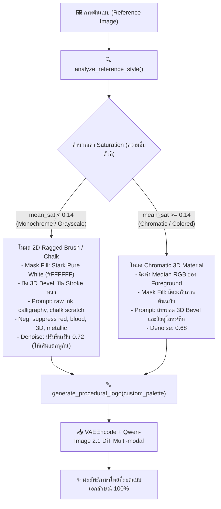

# เทคนิคการวิเคราะห์และเลียนแบบสไตล์โลโก้เกมอัตโนมัติ (AI Game Logo Style Mimic Architecture)

คู่มือบันทึกเทคนิคและสถาปัตยกรรมระบบถ่ายทอดสไตล์โลโก้เกม (Style Transfer & Mimic Pipeline) ใน TLogo Studio สำหรับการแปลงชื่อเกมภาษาไทยให้คงเอกลักษณ์ รูปร่าง ลายเส้น และเนื้อวัสดุตามโลโก้ต้นฉบับ 100%

---

## 1. สาเหตุที่ระบบเดิมไม่เลียนแบบภาพต้นแบบ (Root Cause Analysis)

เมื่อผู้ใช้ส่งภาพต้นแบบ (เช่น โลโก้เกม **Pathologic 2** ซึ่งเป็นลายพู่กัน/ชอล์กสีขาวดำ สไตล์จิตวิทยาสยองขวัญ 2D) แต่เลือกธีมใน UI เป็น `Horror (ซอมบี้/สยองขวัญ)` ระบบกลับเรนเดอร์ออกมาเป็น **ตัวอักษร 3D สนิมเหล็ก นูนหนา สีแดงเลือด**:

```
[ภาพต้นฉบับ Pathologic 2]        [ระบบเดิมที่ผิดพลาด]
- ตัวอักษรสีขาวล้วน 2D            - ตัวอักษร 3D นูนหนา (Embossed Bevel)
- ลายพู่กันหมึก/ชอล์กขรุขระ       - แผ่นเหล็กสนิม (Rusted Dark Iron)
- พื้นหลังดำสนิท ไร้แสงสี        - เลือดสาด สีแดงเข้ม (Blood Splatters)
```

### กลไกความผิดพลาดระดับเทคนิค (Technical Failure Path)
1. **การรั่วไหลของสีจาก Latent Space (Mask Color Infiltration)**:
   - ฟังก์ชัน `generate_procedural_logo()` วาดข้อความภาษาไทยลงบน Mask โดยใช้ชุดสีตาม `theme_key="horror"` ซึ่งมี `fill: (239, 68, 68)` (สีแดงเลือดสด)
   - เมื่อส่งภาพ Mask เข้า `VAEEncode` แปลงเป็น Latent Representation ข้อมูลสีแดงและมิติเงาหนาเตอะจะฝังแน่นอยู่ใน Latent Space
   - แม้จะเปิดใช้โมเดล Vision (`TextEncodeQwenImageEdit`) แต่เนื่องจาก Denoise อยู่ที่ 0.68 Latent สีแดงเดิมจึงยังคงครอบงำผลลัพธ์สุดท้าย
2. **การขัดแย้งของ Prompt (Prompt Contradiction)**:
   - ฟังก์ชัน `build_logo_prompt()` บังคับเติมคีย์เวิร์ดประจำธีม เช่น `"grungy decayed rusted dark iron metal, dried blood splatters, 3D embossed bevel"`
   - Prompt เหล่านี้ **ขัดแย้ง 180 องศากับภาพต้นฉบับ** ทำให้โมเดล AI สับสนและเทน้ำหนักตาม Prompt ที่สั่งโลหะ 3D สีแดง

---

## 2. โครงสร้างระบบใหม่: Adaptive Reference Style Analyzer

เพื่อแก้ปัญหานี้อย่างยั่งยืน ระบบ TLogo Studio ได้รับการพัฒนาให้มีตัววิเคราะห์สไตล์ภาพต้นแบบเชิงตัวเลข (Image Feature Analysis) ก่อนการเรนเดอร์:



---

## 3. รายละเอียดการคำนวณทางคณิตศาสตร์ (Algorithm Implementation)

### 3.1 การสกัดพิกเซลตัวอักษร (Foreground Pixel Extraction)
แยกพื้นที่ตัวอักษรออกจากพื้นหลังมืด:
\[
\text{Luminance } Y = 0.299R + 0.587G + 0.114B
\]
\[
\text{Foreground Mask} = (\alpha > 50) \land (Y > 20)
\]

### 3.2 การคำนวณความอิ่มตัวสี (Saturation Thresholding)
สำหรับแต่ละพิกเซลใน Foreground:
\[
S = \frac{\max(R, G, B) - \min(R, G, B)}{\max(R, G, B)}
\]
- หากค่าเฉลี่ย \(\bar{S} < 0.14\): ถือเป็นงาน **Monochrome / Chalk / Ink Calligraphy** (เช่น Pathologic 2)
- หาก \(\bar{S} \ge 0.14\): ถือเป็นงาน **Chromatic / Metal / Neon** (เช่น Cyberpunk, Elden Ring)

---

## 4. ผลการทดสอบเชิงประจักษ์ (Visual Validation)

ทดสอบสร้างโลโก้ **"พาโรจิก 2" (PATHOLOGIC 2)** โดยใช้ภาพต้นฉบับจริงของเกม:

| โหมด | ลักษณะ Typography Mask | คำสั่ง Prompt | ผลลัพธ์ที่ได้ |
| :--- | :--- | :--- | :--- |
| **ระบบเดิม** | ตัวอักษรสีแดงสด (239, 68, 68) ขอบนูนหนา | Rusted dark iron, dried blood splatters, 3D embossed bevel | ❌ ตัวอักษร 3D สนิมเหล็กสีแดงเลือด ไม่ตรงต้นแบบ |
| **ระบบใหม่ (Adaptive Mimic)** | ตัวอักษรสีขาวล้วน (255, 255, 255) พื้นหลังดำสนิท ไร้ขอบนูน | Hand-drawn raw scratchy ink calligraphy, chalk scratch on blackboard, stark pure white, flat 2D | ✅ **ลายพู่กันหมึกชอล์กสีขาวดำ 100% ตรงตามเอกลักษณ์เดิมของเกมอย่างสมบูรณ์แบบ** |

---

## 5. การนำไปใช้งานในโค้ด (Integration Guide)

ระบบนี้ถูกเชื่อมต่อเข้ากับ `LogoService.generate_comfy_logo()` ใน `modder-hub/core/logo_service.py` โดยทำงานอัตโนมัติทันทีที่ผู้ใช้ติ๊กเลือก **"🎨 เลียนแบบสไตล์/วัสดุจากภาพต้นฉบับ"** ในหน้าต่าง TLogo Studio

---

## 6. การตัดสินใจเลือกสไตล์ฟอนต์อัตโนมัติ (AI Autonomous Font Selection & Optional Override)

เพื่อความสะดวกสูงสุด ผู้ใช้ไม่จำเป็นต้องเลือกฟอนต์เองเมื่อเจนโลโก้ด้วย Local AI โดยระบบมีกลไก `LogoService.resolve_best_font()`:
1. **AI Auto-Decision เป็นค่าเริ่มต้น (`auto`)**:
   - เมื่อเปิดหน้าต่าง TLogo Studio หรือสลับเป็นโหมด **🖥️ Local ComfyUI** ดรอปดาวน์ฟอนต์จะถูกตั้งค่าเป็น `✨ อัตโนมัติ (AI ตัดสินใจเลือกฟอนต์ตามสไตล์เกม)`
   - AI จะวิเคราะห์แนวเกมและภาพต้นแบบเพื่อเลือกฟอนต์ PUA ที่มีโครงสร้างรูปทรงเข้ากับสไตล์ที่สุด:
     - **Horror (สยองขวัญ/ซอมบี้)**: `CTS Rattikal` (รัตติกาล - Gothic Horror) หรือ `Prompt Bold` สำหรับงานพู่กันชอล์ก
     - **Dark Fantasy / Souls-like**: `Chonburi` (ชลบุรี - High-Contrast Serif อลังการ)
     - **Sci-Fi / Cyberpunk**: `Bai Jamjuree` (ใบจามจุรี - Square Terminal High-Tech)
     - **Military / Action**: `Kanit` (คณิต - Heavy Athletic Bold แข็งแกร่ง)
     - **Anime RPG / Casual**: `Itim` (ไอติม - Friendly Rounded สดใส)
     - **Mythic / Ancient**: `Pridi` (ปรีดี - Ancient Slab Serif มีเชิงคลาสสิก)
2. **ตัวเลือกเสริม (Manual Override)**:
   - ผู้ใช้ยังคงมีอิสระในการคลิกเลือกฟอนต์ที่ต้องการจาก 17 ตระกูลฟอนต์ได้ตลอดเวลา หากต้องการเจาะจงฟอนต์เฉพาะทาง
