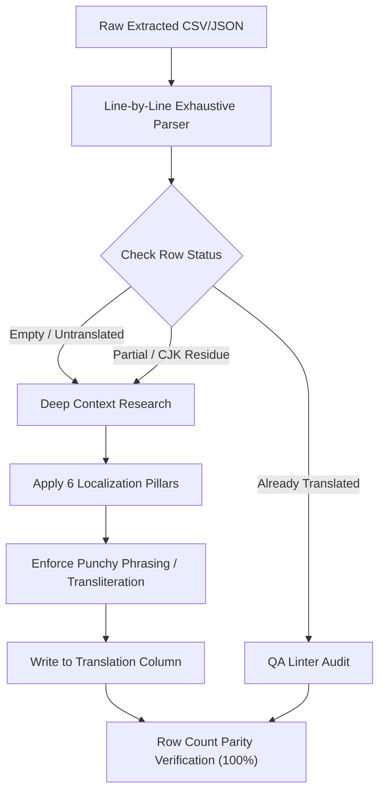

# 📖 Thai Game Skill, Spell & Combat Phrase Localization Master Guide
### Advanced Deep Analysis Edition — Game Mechanics, Fantasy Compounds & Anti-MT Architecture
> **System:** THub AI Copilot & TStudio Localization Ecosystem  
> **Category:** Localization Techniques & Terminology Standards  
> **Status:** ✅ Active Production Standard  
> **Author:** THub Modding Team & หน๊ด หนวด translator (NodNuatTranslator)  
> **Last Updated:** 2026-10-14  

---

## 📌 สารบัญ (Table of Contents)
1. [บทนำและปัญหาของระบบแปลภาษาต้นทาง (Introduction & Problem Analysis)](#1-บทนำและปัญหาของระบบแปลภาษาต้นทาง)
2. [กฎเหล็กการอ่านครบทุกประโยคแบบ 100% ห้ามข้าม (100% Comprehensive Sentence Reading)](#2-กฎเหล็กการอ่านครบทุกประโยคแบบ-100-ห้ามข้าม)
3. [การสืบค้นบริบทและ Lore ของสกิลอย่างละเอียด (Pre-Translation Deep Context & Lore Research)](#3-การสืบค้นบริบทและ-lore-ของสกิลอย่างละเอียด)
4. [สูตรการตั้งชื่อสกิลเกมแฟนตาซี — "วลีสั้น สละสลวย ได้ใจความ" (Punchy Poetic Compounds)](#4-สูตรการตั้งชื่อสกิลเกมแฟนตาซี--วลีสั้น-สละสลวย-ได้ใจความ)
5. [การใช้ทับศัพท์สำหรับคำเฉพาะและชื่อเฉพาะ (Strict Transliteration for Proper Nouns & Jargon)](#5-การใช้ทับศัพท์สำหรับคำเฉพาะและชื่อเฉพาะ)
6. [บัญชีดำคำแปลกลไกเกมผิดมหันต์ & ระบบตรวจแก้อัตโนมัติ (Anti-MT Blacklist & Auto-Fix Matrix)](#6-บัญชีดำคำแปลกลไกเกมผิดมหันต์--ระบบตรวจแก้อัตโนมัติ)
7. [สถาปัตยกรรมการบังคับใช้ในระบบ TStudio & THub (System Architecture & Enforcement)](#7-สถาปัตยกรรมการบังคับใช้ในระบบ-tstudio--thub)

---

## 1. บทนำและปัญหาของระบบแปลภาษาต้นทาง
ในการแปลวิดีโอเกม (Game Localization) โดยเฉพาะแนวแฟนตาซี (Fantasy RPG), แอ็กชัน (Action / Souls-like), หรือกลยุทธ์ (Tactical Strategy) **ชื่อสกิล (Skill Names), ชื่อคาถา (Spell Names), ท่าไม้ตาย (Ultimate Abilities), และวลีการต่อสู้ (Combat Phrases)** ถือเป็นหัวใจสำคัญอย่างยิ่งต่ออรรถรสของผู้เล่น

### ⚠️ สาเหตุของความล้มเหลวในการแปลจาก AI ต้นทาง (Root Causes of MT Failure):
1. **การแปลตรงตัวคำต่อคำ (Literal Translation Stiffness):**
   - AI ทั่วไปจะมองคำศัพท์แบบไร้บริบท เช่น เจอคำว่า `Strike` แปลเป็น `การนัดหยุดงาน`, เจอ `Cast` แปลเป็น `การหล่อโลหะ` หรือ `คัดเลือกนักแสดง`, เจอ `Cooldown` แปลเป็น `การเย็นลง`, เจอ `Checkpoint` แปลเป็น `จุดตรวจทางทหาร`
2. **การแปลเป็นประโยคยาวเหยียดและรุ่มร่าม (Sentence Bloating):**
   - แทนที่จะแปลชื่อสกิลให้เป็นชื่อเฉพาะที่สั้นกระชับ กลับแปลอธิบายความหมาย เช่น `Flame Slash` ถูกแปลเป็น *"การฟันด้วยดาบที่มีเปลวไฟลุกไหม้"* ซึ่งยาวเกินกล่อง UI ของเกมและทำลายความรู้สึกของสกิล
3. **การแถแปลมั่วซั่วเมื่อเจอคำเฉพาะ (Hallucinated Fabrications):**
   - เมื่อ AI พบชื่อเฉพาะในตำนาน หรือศัพท์แฟนตาซีที่ไม่มีในพจนานุกรม เช่น `Gungnir Strike`, `Ragnarok`, `Valkyrie Drive` ระบบมักพยายามฝืนแปลแยกคำแบบไร้ทิศทาง แทนที่จะใช้ **"การทับศัพท์ (Transliteration)"**
4. **พฤติกรรมการอ่านข้ามประโยค (String Skimming / Skipping):**
   - เมื่อเจอดาต้าเบสเกมขนาดหลายหมื่นบรรทัด AI มักสรุปย่อ ข้ามแถวสั้นๆ หรือละไว้ในฐานที่เข้าใจ ทำให้สกิลหรือวลีบางประโยคตกค้างเป็นภาษาอังกฤษ

---

## 2. กฎเหล็กการอ่านครบทุกประโยคแบบ 100% ห้ามข้าม
ระบบประมวลผลการแปล (TStudio Lite, TRun, Autonomous Agent, AI Copilot) ต้องปฏิบัติตาม **Zero-Omission Protocol**:



### 🛑 ข้อบังคับเข้มงวด:
1. **ห้ามข้ามแถว (No Row Skipping):** ระบบต้องอ่านและประมวลผลทุกแถวเรียงตามลำดับ ห้ามใช้ทางลัดประเภท `... (ส่วนที่เหลือแปลเหมือนเดิม)`
2. **ห้ามทิ้งค่าว่าง (No Blank Cells):** หากแถวนั้นเป็นข้อความบทสนทนา, สกิล, หรือ UI ต้องได้รับการแปลครบถ้วน
3. **ตรวจสอบความเท่ากันของแถวก่อนแพ็ก (Row Parity Check):** จำนวนบรรทัดของ `translate_TH.csv` ต้องเท่ากับ `en_original.csv` แบบ 1:1 เสมอ

---

## 3. การสืบค้นบริบทและ Lore ของสกิลอย่างละเอียด
ก่อนจะแปลชื่อสกิลหรือท่าโจมตีใดๆ AI ต้องทำการสืบค้นข้อมูลเชิงลึก 5 มิติ (The 5-Dimensional Context Discovery):

| มิติการวิเคราะห์ | องค์ประกอบที่ต้องตรวจสอบ | ผลกระทบต่อสำนวนภาษา |
| :--- | :--- | :--- |
| **1. ธีมและแนวเกม (Game Universe)** | Fantasy, Dark Fantasy, Sci-Fi, Wuxia, Modern | เลือกใช้คลังคำโบราณ ทรงพลัง หรือทันสมัยตามธีม |
| **2. สายอาชีพและอาวุธ (Class & Weapon)** | นักดาบ (Sword), จอมเวท (Staff/Orb), โจร (Dagger), นักบวช (Mace/Holy Symbol) | กำหนดกริยาการโจมตี เช่น ฟัน, แทง, ร่าย, ปัดป้อง |
| **3. ธาตุและคุณลักษณะ (Element & School)** | เพลิง (Fire), เหมันต์ (Ice), อสุนีบาต (Lightning), ศักดิ์สิทธิ์ (Holy), ทมิฬ (Dark) | กำหนดคำคุณศัพท์เสริมพลัง เช่น เพลิงผลาญ, สายฟ้าฟาด |
| **4. แอนิเมชันและเอฟเฟกต์ (Animation Context)** | ท่าฟันหมุน (Spin), ทิ่มแทง (Thrust), ระเบิดคลื่น (Nova), ห่าฝน (Rain), ม่านคุ้มภัย (Ward) | กำหนดรูปทรงและลักษณะการเคลื่อนไหว |
| **5. ประเภทสกิล (Skill Tier & Type)** | Passive (ติดตัว), Active (กดใช้), Ultimate (ท่าไม้ตาย), Buff/Debuff | กำหนดระดับความอลังการของคำ |

---

## 4. สูตรการตั้งชื่อสกิลเกมแฟนตาซี — "วลีสั้น สละสลวย ได้ใจความ"
สำหรับเกมแนวแฟนตาซี หากชื่อสกิลภาษาอังกฤษสั้นหรือความยาวปานกลาง (1–3 คำ):
- ❌ **ห้ามแปลเป็นประโยคคำอธิบาย:** ห้ามมีคำฟุ่มเฟือย เช่น "การ...", "ความ...", "ที่เป็น..."
- ✅ **ให้สร้างเป็น "วลีสั้นๆ 2–6 พยางค์" (Poetic Compound Words):**

### 📐 โครงสร้างการร้อยคำสกิลแฟนตาซี:
$$\text{[ธาตุ / พลังเสริม]} + \text{[อาวุธ / กิริยาการโจมตี]} \quad \text{หรือ} \quad \text{[กิริยาฟาดฟัน]} + \text{[เป้าหมาย / ผลลัพธ์]}$$

### ⚔️ ตารางเปรียบเทียบตัวอย่างการแปลจริง:

| ชื่อสกิลภาษาอังกฤษ (Source) | แปลตรงตัวแบบ AI ทั่วไป (Literal MT ❌) | มาตรฐาน THub & TStudio (Punchy Localization ✅) | คำอธิบายโครงสร้าง |
| :--- | :--- | :--- | :--- |
| `Flame Slash` | การสแลชเปลวไฟ / ฟันด้วยไฟ | **ดาบเพลิงพิฆาต / เพลิงดาบฟาดฟัน** | [ธาตุเพลิง] + [กิริยาดาบ] |
| `Shadow Step` | ขั้นตอนเงา / ก้าวเท้าในเงามืด | **ก้าวเงา / ย่างก้าวเงา** | วลีสั้น 2–3 พยางค์ คล่องแคล่ว |
| `Frost Nova` | โนวาที่หนาวเย็น | **ระเบิดเยือกแข็ง / ระเบิดเหมันต์** | [ผลลัพธ์กระจายตัว] + [ธาตุน้ำแข็ง] |
| `Thunder Strike` | การนัดหยุดงานสายฟ้า / การตีฟ้าผ่า | **สายฟ้าฟาด / อสุนีบาตฟาด** | ตัดข้อผิดพลาด Strike ➔ ฟาด |
| `Whirlwind Strike` | การนัดหยุดงานลมบ้าหมู | **วายุฟาดฟัน / พายุดาบหมุน** | วลีสละสลวยตามการเคลื่อนไหว |
| `Divine Smite` | การทุบตีศักดิ์สิทธิ์ | **ทัณฑ์เทวา / ทัณฑ์ศักดิ์สิทธิ์** | ภาษาแฟนตาซีชั้นสูงสำหรับ Paladin |
| `Soul Harvest` | การเก็บเกี่ยวผลผลิตวิญญาณ | **กลืนวิญญาณ / เก็บเกี่ยววิญญาณ** | สกิล Necromancer/สายมืด |
| `Bloodthirst` | ความกระหายในเลือด | **กระหายเลือด / จิตกระหายเลือด** | กระชับ ดุดัน สั้นตรงตัว |
| `Iron Will` | ความต้องการทำเหล็ก | **จิตเหล็กกล้า / เจตจำนงเหล็กกล้า** | บ่งบอกความทรหดของสายแทงก์ |
| `Blade Dance` | การเต้นรำของใบมีด | **ระบำดาบ / ดาบร่ายรำ** | สละสลวย คล่องแคล่ว พริ้วไหว |
| `Dragon Roar` | เสียงตะโกนของมังกร | **คำรามมังกร / กึกก้องมังกร** | ทรงพลัง หนักแน่น |

---

## 5. การใช้ทับศัพท์สำหรับคำเฉพาะและชื่อเฉพาะ
หากชื่อสกิลมี **คำเฉพาะ (Proper Nouns), ชื่อเทพ/มารในตำนาน, หรือศัพท์เฉพาะของจักรวาลเกมที่หาคำแปลภาษาไทยตรงตัวไม่ได้**:
- ✅ **ต้องใช้การทับศัพท์ (Transliteration) เป็นหลัก**
- ❌ **ห้ามแปลแถหรือแต่งคำแปลมั่วซั่วที่ไม่เกี่ยวข้องกันขึ้นมาเด็ดขาด**

### 🔮 หมวดหมู่คำศัพท์ที่ต้องทับศัพท์:
1. **ชื่อเทพปกรณัม / สัตว์อสูรในตำนาน / อาวุธเทวะ:**
   - `Ragnarok` ➔ **"แร็กนาร็อค"** *(ห้ามแปลแถเป็น "วันสิ้นโลกแห่งสงคราม")*
   - `Gungnir Strike` ➔ **"กุงเนียร์สไตรค์"** / **"หอกกุงเนียร์ฟาดฟัน"**
   - `Excalibur` ➔ **"เอ็กซ์คาลิเบอร์"**
   - `Aegis Shield` ➔ **"โล่อีจิส"**
   - `Valkyrie Drive` ➔ **"วาลคิรีไดรฟ์"**
   - `Bahamut Flare` ➔ **"บาฮามุตแฟลร์"**
2. **ลำดับขั้นของคาถาเฉพาะ (Tiered Spell Nomenclature):**
   - `Fire` / `Fira` / `Firaga` ➔ **"ไฟร์"** / **"ฟิร่า"** / **"ฟิเรก้า"**
   - `Blizzard` / `Blizzara` / `Blizzaga` ➔ **"บลิซซาร์ด"** / **"บลิซซาร่า"** / **"บลิซซาก้า"**
   - `Meteor` ➔ **"เมเทโอ"** (หรือ "อุกกาบาต")
   - `Curaga` ➔ **"คูราก้า"**
3. **คำศัพท์กลไกการเล่นและท่วงท่าสากล (Universal Combat Mechanics):**
   - `Dash` ➔ **"แดช"**
   - `Parry` ➔ **"แพร์รี่"** (หรือ "ปัดป้อง")
   - `Counter` ➔ **"เคาน์เตอร์"** (หรือ "สวนกลับ")
   - `Burst` ➔ **"เบิร์ส"**
   - `Stance` ➔ **"สแตนซ์"** (หรือ "ท่วงท่า")
   - `Berserk` ➔ **"เบอร์เซิร์ก"** (หรือ "คลุ้มคลั่ง")
   - `Limit Break` ➔ **"ลิมิตเบรก"**
   - `Overdrive` ➔ **"โอเวอร์ไดรฟ์"**
   - `Mana Burn` ➔ **"เบิร์นมานา"** / **"เผาผลาญมานา"**

---

## 6. บัญชีดำคำแปลกลไกเกมผิดมหันต์ & ระบบตรวจแก้อัตโนมัติ

| ศัพท์ต้นฉบับ (Source) | คำแปลผิดมหันต์จาก MT (Blacklist ❌) | คำแปลที่ถูกต้องตามมาตรฐานเกม (Standard ✅) | สถานะ Auto-Fix ใน TStudio |
| :--- | :--- | :--- | :--- |
| `Checkpoint` | จุดตรวจ, ด่านตรวจทหาร | **เช็คพอยท์, จุดเช็คพอยท์** | ✅ ตรวจจับ & แก้ทันที |
| `Strike` | นัดหยุดงาน, ประท้วงหยุดงาน | **ฟาดฟัน, จู่โจม, ประหาร** | ✅ ตรวจจับ & แก้ทันที |
| `Cast / Casting` | หล่อโลหะ, หล่อขึ้นรูป, คัดเลือกนักแสดง | **ร่าย, การร่ายเวท** | ✅ ตรวจจับ & แจ้งเตือน QA |
| `Cooldown` | เย็นลง, การระบายความร้อน | **คูลดาวน์, เวลารอใช้ใหม่** | ✅ ตรวจจับ & แก้ทันที |
| `Passive Skill` | ทักษะเฉยชา, สกิลไม่กระตือรือร้น | **สกิลติดตัว, ทักษะติดตัว** | ✅ ตรวจจับ & แก้ทันที |
| `Active Skill` | ทักษะกระตือรือร้น, สกิลคล่องแคล่ว | **สกิลกดใช้, ทักษะกดใช้** | ✅ ตรวจจับ & แจ้งเตือน QA |
| `Critical Hit` | การโจมตีวิกฤต, วิกฤตการณ์ | **คริติคอล, โจมตีติดคริ** | ✅ ตรวจจับ & แก้ทันที |
| `Bleed / Bleeding` | ตกเลือด, เลือดออกทางบาดแผล | **เลือดออก, ติดสถานะเลือดไหล** | ✅ ตรวจจับ & แจ้งเตือน QA |
| `Stun` | ทำให้ตกตะลึง, ทำให้ประหลาดใจ | **สตัน, มึนงง** | ✅ ตรวจจับ & แจ้งเตือน QA |
| `Lifesteal` | ขโมยชีวิต | **ดูดเลือด** | ✅ ตรวจจับ & แก้ทันที |
| `Respawn` | วางไข่ | **เกิดใหม่, จุดเกิดใหม่** | ✅ ตรวจจับ & แก้ทันที |
| `Save Point` | จุดประหยัด | **จุดบันทึก, จุดเซฟ** | ✅ ตรวจจับ & แจ้งเตือน QA |

---

## 7. สถาปัตยกรรมการบังคับใช้ในระบบ TStudio & THub

```
[Translation Workflow]
       │
       ▼
 1. Prompt Engine (modder-hub/ai/prompt_engine.py)
    • บังคับใช้ใน เสาหลักที่ 3 (Skill & Combat Phrase Protocol)
    • กำชับ AI ให้ทำ Deep Lore Research และใช้สูตรวลีสั้นสละสลวย / ทับศัพท์
    • กำชับ Zero-Omission: อ่านทุกประโยค ห้ามข้ามเด็ดขาด
       │
       ▼
 2. Machine Translation Pre/Post-Filter (tstudio_lite/core/google_translator.py)
    • Auto-clean สกัดคำแปลผิดมหันต์ (นัดหยุดงาน, เย็นลง, ขโมยชีวิต, จุดตรวจ) ทันที
       │
       ▼
 3. Real-Time QA Linters (tstudio_lite/qa/thai_checker.py & tstudio-web/src/lib/qa/thaiChecker.ts)
    • สแกนและขึ้น Badge เตือนแบบเรียลไทม์เมื่อตรวจพบข้อผิดพลาด
    • ปุ่ม One-Click Auto-Fix กดแก้กลับเป็นคำมาตรฐานในคลิกเดียว
       │
       ▼
 4. Default Gaming Glossary (tstudio_lite/qa/glossary.py)
    • โหลดคำศัพท์กลไกสากลเข้าพจนานุกรมออฟไลน์ประจำโปรเจกต์ตั้งแต่เริ่มเปิดโปรแกรม
```

คู่มือนี้ถือเป็นมาตรฐานวิศวกรรมย้อนกลับและการแปลเกมภาษาไทยประจำคลัง `Modding-Knowledge` เพื่อให้ทุกโปรเจกต์ม็อดของชุมชนรักษามาตรฐานสูงสุดทั้งในแง่เทคนิคและวรรณศิลป์ครับ.
