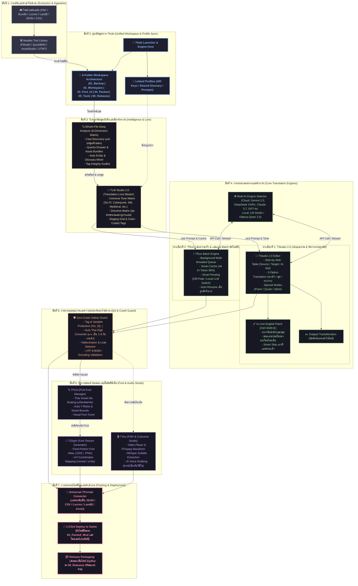

# 🗺️ THub & TStudio 2.0: Complete Pipeline Architecture

เอกสารผังโครงสร้างสถาปัตยกรรมและไปป์ไลน์การทำงานทั้งหมดของ **THub Ecosystem** และ **TStudio 2.0** ตั้งแต่ขั้นตอนการสกัดไฟล์เกม (Extraction) จนถึงการ Deploy ม็อดเข้าตัวเกมจริง (Final Deployment)

---

## 📊 ผังภาพไปป์ไลน์การทำงานแบบองค์รวม (End-to-End Master Pipeline)

---

## 🔄 เจาะลึกกระบวนการทำงานในแต่ละสเต็ป (Step-by-Step Data Flow)

### 1️⃣ การสกัดไฟล์ (Asset Ingestion)
- นักม็อดใช้ชุดเครื่องมือแกะไฟล์ใน **Modder Tool Library** ที่ฝังอยู่ใน THub (เช่น FModel สำหรับ Unreal Engine, AssetStudio สำหรับ Unity หรือ UTMT สำหรับ GameMaker) เพื่อดึงข้อความดิบออกมา
- ไฟล์ดิบจะถูกจัดเก็บเข้า `01_Original_Backup/` เพื่อความปลอดภัย ไม่ให้มีข้อมูลสูญหาย

### 2️⃣ ตั้งค่าและเชื่อมต่อผ่าน THub (Workspace & Profile Sync)
- เมื่อสร้างโปรเจกต์ใน THub ระบบจะจำลองโครงสร้างโฟลเดอร์ทำงาน 6 โฟลเดอร์มาตรฐาน
- ค่า API Key (Google, DeepSeek, Claude, OpenAI), พจนานุกรมคำศัพท์ (Glossary) และ Prompt สากล จะถูกแชร์ให้กับทุกเครื่องมือใน Suite โดยอัตโนมัติ

### 3️⃣ วิเคราะห์เนื้อหาและวางกลยุทธ์ (Deep Intelligence & Lore Staging)
- **Whole-File Deep Analyzer**: สแกนหาความสัมพันธ์ของบทสนทนา, นับบรรทัดของตัวละครแต่ละตัว (Dramatis Personae), แยกเควสต์ และดึงชื่อเฉพาะออกมาเป็นคลังศัพท์อัตโนมัติ
- **TLM Studio 2.0**: ล็อก "จักรวาลของเกม" (Universe Tone) เพื่อกำหนดสรรพนาม โทนเสียง และคำสั่ง Directive Matrix ให้ AI ปฏิบัติตามอย่างเคร่งครัด

### 4️⃣ ดำเนินการแปลด้วย AI (Dual Translation Paths)
- **เส้นทาง TStudio 2.0 (เน้นคุณภาพงานแปล)**:
  - เหมาะสำหรับแปลเนื้อเรื่องหลักและบทสนทนาสำคัญ
  - สามารถเลือกแปล 3 รูปแบบพร้อมกัน หรือใช้โหมดแปลบทกวี/สำนวน
  - **ฟีเจอร์เด็ด 🩹 In-Line English Patch (`Ctrl+Shift+E`)**: ซ่อมแซมเฉพาะคำภาษาอังกฤษที่หลุดออกมา โดยไม่ลบโครงสร้างประโยคไทยเดิมที่ขัดเกลาไว้
- **เส้นทาง TRun (เน้นความเร็วและคิวงานขนาดใหญ่)**:
  - เหมาะสำหรับไฟล์เมนู, รายการไอเทม, หรือสคริปต์ขนาดหมื่นบรรทัด
  - ทำงานอัตโนมัติเบื้องหลัง พร้อมระบบ Smart Cache ลดต้นทุนโทเค็นลงถึง 90%

### 5️⃣ ตรวจสอบความปลอดภัยและคุณภาพ (Zero-Crash QA Guard)
- **Tag Protection**: ตรวจสอบและป้องกันตัวแปรของเกมไม่ให้เสียหาย เช่น `%s`, `{0}`, `<color=red>`, `\n`
- **Auto Thai Digit Converter**: สแกนและแปลงเลขไทย (๑-๙) ให้กลับเป็นเลขอารบิก (1-9) โดยอัตโนมัติ ป้องกันไม่ให้เอนจิ้นเกม Crash
- **Encoding Check**: ตรวจสอบการเข้ารหัส UTF-8 และ BOM ให้เข้ากับระบบไฟล์ของเกม

### 6️⃣ แก้สระลอยและจัดการมัลติมีเดีย (Typography & Audio Studio)
- **TPUA**: นำข้อความที่ผ่านการแปลแล้วมาจัดเรียงรหัสตัวอักษรใหม่อยู่ในย่าน PUA (Private Use Area) เพื่อแก้ปัญหาสระลอย/สระจม
- **TGlyph**: เรนเดอร์ฟอนต์เป็น Texture Atlas (.DDS, .PNG) พร้อมสร้างตารางพิกัด UV ไปใส่ในเอนจิ้นเกม
- **TVox**: สำหรับเกมที่มีคัทซีนวิดีโอ (FMV) สามารถเล่นพรีวิวซับไตเติลแบบเรียลไทม์ พร้อมระบบ AI ถอดเสียงและพากย์เสียงภาษาไทยทับวิดีโอเดิม

### 7️⃣ ประกอบไฟล์และติดตั้งลงเกม (Packaging & 1-Click Deploy)
- **TFormat Engine**: แปลงไฟล์คำแปลกลับไปเป็นฟอร์แมตดั้งเดิมของตัวเกม
- **1-Click Deploy**: คัดลอกและจัดเรียงไฟล์เข้าสู่โฟลเดอร์เกมจริงเพื่อทดสอบการเล่นได้ทันที
- **Release Packaging**: บีบอัดไฟล์ม็อดสำเร็จรูปลงใน `06_Releases/` พร้อมสร้างเอกสาร Readme สำหรับนำไปแจกจ่ายให้ผู้เล่น

---

## 💡 สรุปจุดเด่นของสถาปัตยกรรม (Architectural Highlights)

| ด้าน | จุดเด่น | ผลลัพธ์ที่ได้ |
| :--- | :--- | :--- |
| **ความลื่นไหลของระบบ (Performance)** | สถาปัตยกรรม Asynchronous Multi-threading (PyQt6) | หน้าต่างโปรแกรมไม่ค้าง แม้ AI กำลังสตรีมข้อมูลหรือแปลไฟล์เป็นหมื่นบรรทัด |
| **การประหยัดทรัพยากร (Cost Efficiency)** | Translation Memory & Smart Cache (Exact & Fuzzy Match) | ประหยัดค่าบริการ AI API สูงถึง 90% เมื่อเทียบกับการแปลแบบดั้งเดิม |
| **ความแม่นยำของงานแปล (Quality & Tone)** | TLM Lore Master + Contextual In-Line Patching | คุมสรรพนามตรงตามจักรวาลเกม ซ่อมคำหลุดได้โดยไม่ทำลายสำนวนเดิม |
| **ความปลอดภัยของตัวเกม (Stability)** | Tag Guard + Thai Digit Converter + Encoding Validator | ม็อดไม่ทำให้เกมหลุด (Crash-Free) และแสดงผลได้อย่างสมบูรณ์แบบ |
